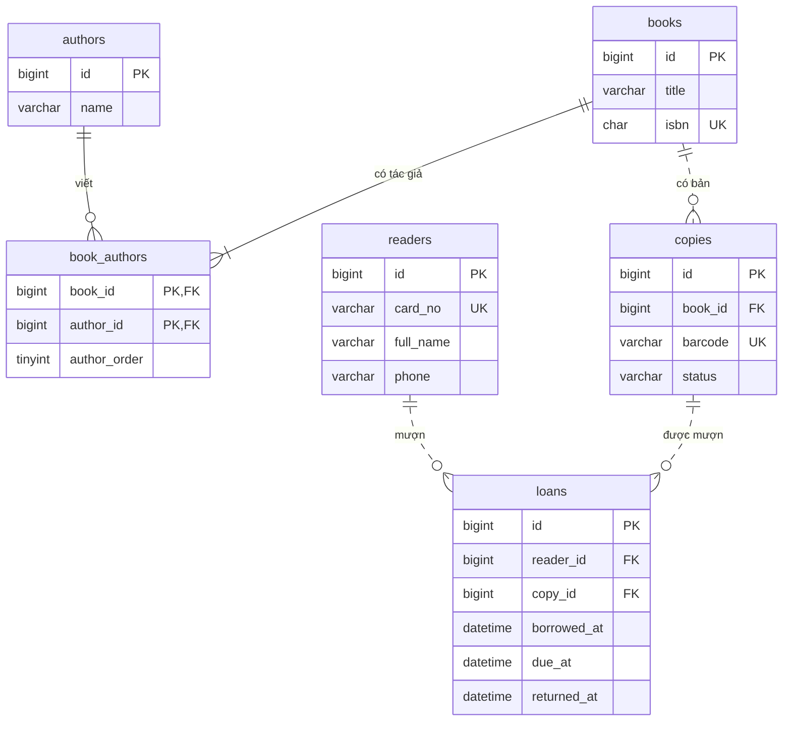
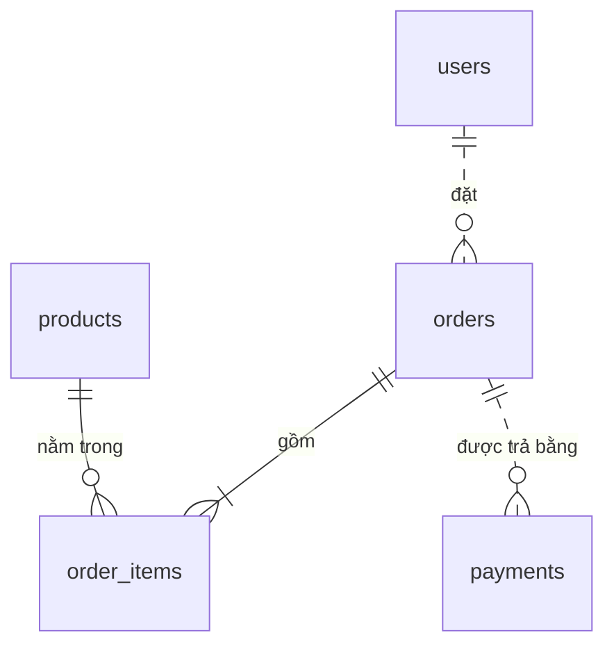

# Chương 02. Mô hình quan hệ và thiết kế dữ liệu

> [← Mục lục](README.md) · [← Chương 01: Database là gì và cài đặt MySQL](01-database-la-gi.md) · [Chương 03: Kiểu dữ liệu →](03-kieu-du-lieu.md)

**Bạn sẽ học được:**

- Nhìn một bảng theo cách mô hình quan hệ nhìn nó: quan hệ, bộ, thuộc tính, miền giá trị, và những
  chỗ SQL lệch khỏi lý thuyết.
- Chuyển một mô tả nghiệp vụ bằng lời thành thực thể, thuộc tính, mối quan hệ, rồi vẽ thành ERD.
- Phân biệt super key, candidate key, primary key, natural key, surrogate key, foreign key, và chọn
  khoá có lý do.
- Cài đặt quan hệ 1-1, 1-n, n-n bằng bảng và khoá ngoại.
- Nhận ra dị thường dữ liệu, dùng phụ thuộc hàm để đưa bảng về 1NF, 2NF, 3NF, BCNF, và biết khi nào
  được phép phá chuẩn.
- Tự thiết kế từ đầu schema của một cửa hàng: `users`, `products`, `orders`, `order_items`,
  `payments`.

**Cần biết trước:** [Chương 01](01-database-la-gi.md): biết database là gì, chạy được MySQL và gõ
lệnh trong client `mysql`.

Các ví dụ SQL trong chương chạy trên MySQL 8.4. Nếu chưa có MySQL, chạy bằng Docker (trên máy của
bạn, ở terminal bất kỳ):

```bash
docker run -d --name my84 -e MYSQL_ROOT_PASSWORD=root mysql:8.4
# đợi vài giây cho server khởi động xong, rồi mở client:
docker exec -it my84 mysql -uroot -proot
```

Trong client `mysql`, tạo một database riêng cho chương này để thử thoải mái:

```sql
CREATE DATABASE ch02;
USE ch02;
```

Chương này nói nhiều về *cấu trúc* (bảng nào, cột nào, khoá nào). Kiểu dữ liệu của từng cột được giải
thích ở [chương 03](03-kieu-du-lieu.md), cú pháp đầy đủ của `CREATE TABLE` và các ràng buộc ở
[chương 04](04-ddl-constraint.md). Ở đây bạn chỉ cần đọc hiểu được các câu `CREATE TABLE` đơn giản.

## 1. Mô hình quan hệ: nhìn bảng bằng con mắt lý thuyết

Ở chương 01 bạn đã tạo bảng và chạy câu `SELECT` đầu tiên. Chương này lùi lại một bước để hỏi: dữ
liệu của một ứng dụng nên được chia thành những bảng nào, mỗi bảng có những cột nào, các bảng nối với
nhau ra sao. Đó là việc *thiết kế dữ liệu* (data modeling, database design). Thiết kế tốt thì câu
truy vấn đơn giản và dữ liệu khó bị sai. Thiết kế tồi thì mọi tầng phía trên (code PHP, báo cáo, API)
phải gánh hậu quả, và sửa lại cấu trúc của một bảng đã có hàng trăm triệu dòng là việc tốn kém
([chương 20](20-thay-doi-schema-migration.md)).

Trước khi thiết kế, cần hiểu "bảng" trong database quan hệ thực chất là gì.

### 1.1 Mô hình quan hệ từ đâu ra

Năm 1970, Edgar F. Codd (làm việc ở IBM) công bố bài báo *A Relational Model of Data for Large Shared
Data Banks* trên tạp chí Communications of the ACM (tập 13, số 6). Câu mở đầu bài báo:

> Future users of large data banks must be protected from having to know how the data is organized
> in the machine (the internal representation).

Tức là: người dùng dữ liệu không nên phải biết dữ liệu được sắp xếp thế nào bên trong máy.

Bối cảnh lúc đó: theo chính bài báo, các hệ thống đang có cung cấp cho người dùng "tree-structured
files or slightly more general network models of the data", tức dữ liệu tổ chức dạng cây hoặc dạng
mạng. Chương trình phải đi theo đúng đường dẫn trong cây hay mạng đó để tới được dữ liệu, nên khi cấu
trúc lưu trữ thay đổi thì chương trình hỏng theo. Codd đề xuất: mọi dữ liệu đều biểu diễn bằng các
*quan hệ* (relation), mà ta quen gọi là bảng; người dùng mô tả mình cần dữ liệu gì, còn hệ thống tự lo
cách lấy. MySQL, PostgreSQL, Oracle, SQL Server đều xây trên ý tưởng này, nên được gọi là *relational
database* (database quan hệ), và quản lý bởi một *RDBMS* (relational database management system).

⚠️ Chữ "quan hệ" trong "database quan hệ" là *relation*, nghĩa là cái bảng, không phải "mối liên kết
giữa các bảng" (*relationship*). Một database chỉ có đúng một bảng vẫn là database quan hệ. Hai từ
relation và relationship sẽ xuất hiện liên tục trong chương này, đừng lẫn chúng.

### 1.2 Quan hệ, bộ, thuộc tính, miền giá trị

Codd dùng chữ relation "in its accepted mathematical sense" (theo nghĩa toán học quen thuộc): cho các
tập S1, S2, ..., Sn, một quan hệ R trên n tập đó là một tập các bộ n phần tử (*n-tuple*), mỗi bộ có
phần tử thứ nhất lấy từ S1, phần tử thứ hai lấy từ S2, và cứ thế. Mỗi tập Sj gọi là một *domain* (miền
giá trị) của R, và n gọi là *degree* (bậc) của R.

Nói bằng lời thường: một quan hệ là một bảng; mỗi dòng là một bộ giá trị; mỗi cột có tên và chỉ được
nhận giá trị trong một tập cho phép.

```
                    attribute (thuộc tính) = một cột
                ┌──────┬───────────────┬────────┐
 relation       │ id   │ name          │ price  │  ← heading: tên các thuộc tính
 "products"     ├──────┼───────────────┼────────┤
                │ 1    │ Bút bi        │ 5000   │  ← tuple (bộ) = một dòng
                │ 2    │ Vở 96 trang   │ 12000  │
                │ 3    │ Thước kẻ      │ 7000   │
                └──────┴───────────────┴────────┘
   degree (bậc) = 3 thuộc tính         cardinality (lực lượng) = 3 bộ
   domain của price: các số nguyên không âm (do nghiệp vụ quy định)
```

Bảng đối chiếu thuật ngữ, vì sách lý thuyết, tài liệu MySQL và đồng nghiệp sẽ dùng lẫn lộn:

| Lý thuyết | SQL, MySQL | Lời thường |
|---|---|---|
| relation (quan hệ) | table | bảng |
| tuple (bộ) | row, record | dòng, bản ghi |
| attribute (thuộc tính) | column, field | cột |
| domain (miền giá trị) | kiểu dữ liệu cộng ràng buộc | tập giá trị hợp lệ của một cột |
| degree (bậc) | số cột | |
| cardinality (lực lượng) | số dòng | |
| relation schema (lược đồ quan hệ) | định nghĩa bảng (`CREATE TABLE`) | cái khuôn của bảng |

Miền giá trị nói nhiều hơn kiểu dữ liệu. Cột `price` kiểu `INT` vẫn nhận được giá trị `-5`, nhưng
miền giá trị theo nghiệp vụ là "số nguyên không âm". SQL biểu diễn miền giá trị bằng kiểu dữ liệu
([chương 03](03-kieu-du-lieu.md)) cộng với ràng buộc như `NOT NULL`, `CHECK`
([chương 04](04-ddl-constraint.md)). Phần nào của miền giá trị không được khai báo thành ràng buộc thì
database không bảo vệ, và dữ liệu sai sẽ lọt vào.

⚠️ Chữ *cardinality* được dùng cho ba thứ khác nhau trong thế giới database: số dòng của một quan hệ
(như trên), kiểu "một hay nhiều" của một mối quan hệ 1-1, 1-n (mục 2.3), và số giá trị khác nhau trong
một index (cột `Cardinality` của `SHOW INDEX`, [chương 11](11-index.md)). Gặp chữ này thì xem ngữ
cảnh.

### 1.3 Tính chất của một quan hệ

Bài báo của Codd liệt kê các tính chất của một bảng biểu diễn quan hệ, trong đó có:

1. Mỗi dòng biểu diễn một bộ của quan hệ.
2. "The ordering of rows is immaterial": thứ tự các dòng không mang ý nghĩa gì.
3. "All rows are distinct": không có hai dòng giống hệt nhau. Quan hệ là một *tập hợp* các bộ, mà tập
   hợp thì không chứa phần tử trùng.

Bài báo cũng tách bạch *simple domain*, miền mà phần tử là giá trị "atomic (nondecomposable)" (nguyên
tử, không chia nhỏ được), với *nonsimple domain*, miền mà mỗi phần tử lại là cả một quan hệ (ví dụ một
nhân viên kèm cả "lịch sử lương" bên trong). Codd đề xuất một thủ tục loại bỏ các miền không đơn giản
và gọi nó là *normalization* (chuẩn hoá). Đây là gốc của dạng chuẩn thứ nhất mà bạn sẽ học ở mục 6.

Từ tính chất 3 suy ra một hệ quả quan trọng: vì không có hai dòng trùng nhau, luôn có một tập cột nào
đó (cùng lắm là tất cả các cột) mà giá trị của nó phân biệt được mọi dòng. Tập cột như vậy gọi là
*khoá* (key), chủ đề của mục 3.

### 1.4 SQL không hoàn toàn là mô hình quan hệ

SQL được xây dựa trên mô hình quan hệ nhưng lệch khỏi nó ở vài chỗ. Biết những chỗ lệch này giúp bạn
tránh vài lỗi rất phổ biến.

Thứ nhất, bảng SQL có thể chứa dòng trùng hoàn toàn nếu bạn không khai báo khoá. Thử trong MySQL:

```sql
CREATE TABLE no_key (name VARCHAR(50), price INT);
INSERT INTO no_key VALUES ('Vở 96 trang', 12000), ('Vở 96 trang', 12000);
SELECT * FROM no_key;
-- Kết quả mong đợi: 2 dòng giống hệt nhau
-- +-------------+-------+
-- | name        | price |
-- +-------------+-------+
-- | Vở 96 trang | 12000 |
-- | Vở 96 trang | 12000 |
-- +-------------+-------+
```

Bây giờ muốn sửa giá của "dòng thứ hai" thì viết `WHERE` thế nào? Không có giá trị nào phân biệt hai
dòng: mọi điều kiện khớp dòng này cũng khớp dòng kia. MySQL có `UPDATE ... LIMIT 1` và
`DELETE ... LIMIT 1` để chỉ đụng tới một dòng bất kỳ trong số các dòng khớp, nhưng đó là chữa cháy,
không phải thiết kế. Bài học: mọi bảng đều nên có khoá chính (mục 3.4).

Thứ hai, SQL có thứ tự cột: `SELECT *` trả các cột theo thứ tự khai báo, và câu
`INSERT INTO no_key VALUES ('Thước kẻ', 7000)` (không ghi tên cột) gán giá trị theo đúng thứ tự đó.
⚠️ Vì vậy trong code ứng dụng luôn ghi rõ tên cột: `INSERT INTO no_key (name, price) VALUES (...)`.
Câu `INSERT` không ghi tên cột sẽ báo lỗi (sai số lượng giá trị) khi bảng được thêm một cột, hoặc tệ
hơn là ghi nhầm cột mà không báo gì nếu ai đó đổi thứ tự cột cùng kiểu.

Thứ ba, đúng như tính chất 2, thứ tự dòng không mang nghĩa: câu `SELECT` không có `ORDER BY` thì
database được phép trả dòng theo bất kỳ thứ tự nào. Lần chạy này có vẻ "theo thứ tự id" chỉ là tình cờ
của cách lưu trữ hiện tại. Cần thứ tự thì luôn viết `ORDER BY` ([chương 05](05-select-co-ban.md)).

Thứ tư, SQL có `NULL`, một dấu hiệu đặc biệt cho "không biết" hoặc "không có giá trị", thứ mà định
nghĩa toán học của quan hệ không có. `NULL` làm nhiều quy tắc logic quen thuộc không còn đúng nữa, và
được bàn riêng ở [chương 06](06-ham-bieu-thuc-null.md).

```sql
DROP TABLE no_key;   -- dọn bảng thử
```

### 1.5 Schema và instance

Hai khái niệm cần tách bạch khi nói về thiết kế:

- *Schema* (lược đồ) là cấu trúc: có những bảng nào, mỗi bảng có cột nào, kiểu gì, khoá và ràng buộc
  gì. Schema ít thay đổi, và mỗi lần thay đổi là một sự kiện có kế hoạch (migration).
- *Instance* (thể hiện, còn gọi là trạng thái của database) là dữ liệu cụ thể tại một thời điểm. Nó
  thay đổi liên tục, mỗi câu `INSERT`, `UPDATE` tạo ra một instance mới.

Thiết kế dữ liệu là thiết kế schema sao cho mọi instance hợp lệ theo nghiệp vụ đều biểu diễn được, và
càng nhiều instance sai càng bị chặn sớm càng tốt.

⚠️ Chữ "schema" còn có nghĩa thứ hai tuỳ hệ quản trị. Trong MySQL, `CREATE SCHEMA` là một tên gọi
khác (synonym) của `CREATE DATABASE`, nên "schema" và "database" là một. Trong PostgreSQL, một
database chứa một hoặc nhiều schema, mỗi schema là một không gian tên chứa bảng, và bảng tạo ra mà
không chỉ định schema sẽ nằm trong schema tên `public`. Chương này dùng "schema" theo nghĩa "cấu trúc
dữ liệu".

### 1.6 Quy trình thiết kế dữ liệu và bản đồ của chương

Thiết kế dữ liệu thường đi qua ba mức, từ trừu tượng tới cụ thể:

```
 Yêu cầu nghiệp vụ (bằng lời)
        │
        ▼
 ① Mô hình khái niệm (conceptual)   thực thể, thuộc tính, mối quan hệ, vẽ thành ERD
        │                            chưa nói tới bảng, kiểu dữ liệu hay database cụ thể
        ▼
 ② Mô hình logic (logical)          bảng, cột, khoá chính, khoá ngoại, chuẩn hoá
        │                            vẫn chưa phụ thuộc MySQL hay PostgreSQL
        ▼
 ③ Mô hình vật lý (physical)        kiểu dữ liệu cụ thể, index, engine, partition...
                                     viết thành DDL chạy trên một database cụ thể
```

Bản đồ của chương đi theo đúng trình tự đó:

- Mục 2: thực thể, thuộc tính, mối quan hệ (mức khái niệm).
- Mục 3: khoá, công cụ để nhận diện từng dòng và nối các bảng.
- Mục 4: cài đặt các kiểu quan hệ 1-1, 1-n, n-n thành bảng.
- Mục 5: ERD, cách vẽ và đọc sơ đồ.
- Mục 6: chuẩn hoá, cách kiểm tra một thiết kế logic có "sạch" không.
- Mục 7: denormalize, khi nào được phá chuẩn và phải trả giá gì.
- Mục 8: ghép tất cả lại, thiết kế schema cửa hàng từ đầu tới DDL chạy được.

Mức vật lý (kiểu dữ liệu, index) chỉ được đụng tới ở mức cần thiết; chi tiết nằm ở chương 03, 04
và [chương 11](11-index.md).

## 2. Thực thể, thuộc tính, mối quan hệ

Trước khi nghĩ tới bảng, người thiết kế cần một cách mô tả thế giới thật mà cả người làm nghiệp vụ
lẫn lập trình viên cùng hiểu. Công cụ phổ biến nhất là *mô hình thực thể - mối quan hệ*
(entity-relationship model, ER model), do Peter Chen đề xuất trong bài *The Entity-Relationship
Model: Toward a Unified View of Data* (ACM Transactions on Database Systems, tập 1, số 1, tháng
3/1976). Mô hình này nhìn thế giới thành các *thực thể* và các *mối quan hệ* giữa chúng, kèm một cách
vẽ sơ đồ gọi là ERD (mục 5).

### 2.1 Thực thể và tập thực thể

Định nghĩa của Chen: "An entity is a 'thing' which can be distinctly identified. A specific person,
company, or event is an example of an entity." *Thực thể* (entity) là một "thứ" phân biệt được với
những thứ khác. Trong một cửa hàng online:

- người: khách hàng Nguyễn Văn An, nhân viên kho Trần Thị Bình;
- vật: sản phẩm "Bút bi xanh", cái kho ở Thủ Đức;
- sự kiện, giao dịch: đơn hàng số 1001, lần thanh toán lúc 9 giờ sáng nay.

Loại thứ ba hay bị bỏ sót. Người mới thường chỉ nghĩ tới "đồ vật" và "người", nhưng phần lớn dữ liệu
có giá trị của một hệ thống là sự kiện: đơn hàng, thanh toán, lượt đăng nhập, lần đổi trạng thái.

*Tập thực thể* (entity set, nhiều sách gọi là entity type) là tập các thực thể cùng loại, có cùng các
tính chất: "khách hàng", "sản phẩm", "đơn hàng". Khi chuyển sang mức logic, mỗi tập thực thể thường
thành một bảng, mỗi thực thể thành một dòng trong bảng đó.

Một thứ là thực thể hay chỉ là thuộc tính của thực thể khác? Không có đáp án tuyệt đối. Chính Chen
ghi chú rằng cùng một thứ (ông lấy ví dụ hôn nhân) có người coi là thực thể, có người coi là mối quan
hệ, và người thiết kế phải quyết định cho phù hợp với môi trường của mình. Một quy tắc thực dụng: một
thứ nên là thực thể khi

- bạn cần lưu thông tin *về* nó (nó có thuộc tính riêng), hoặc
- nó tham gia mối quan hệ riêng với thực thể khác, hoặc
- nó cần một danh sách giá trị hợp lệ do nghiệp vụ quản lý.

Ví dụ "tỉnh/thành phố" trong địa chỉ giao hàng. Nếu chỉ để in lên phiếu giao thì nó là một thuộc
tính (một cột chữ). Nếu cửa hàng tính phí ship theo tỉnh, cần danh sách tỉnh chuẩn để người dùng chọn,
cần thống kê doanh thu theo tỉnh, thì nó là thực thể (bảng `provinces`) và địa chỉ trỏ tới nó.

### 2.2 Thuộc tính

*Thuộc tính* (attribute) là một tính chất của thực thể mà ta cần lưu: khách hàng có họ tên, email,
ngày sinh; sản phẩm có tên, giá. Chen định nghĩa thuộc tính chính xác hơn là một *hàm* ánh xạ mỗi thực
thể vào một tập giá trị (value set): thuộc tính tuổi ánh xạ mỗi nhân viên vào tập "số năm". Cách nhìn
"hàm" này có ích: một thuộc tính cho mỗi thực thể *đúng một* giá trị (hoặc không có giá trị).

Các sách giáo khoa (ví dụ Elmasri & Navathe, *Fundamentals of Database Systems*) phân loại thuộc tính
theo vài trục. Mỗi trục ứng với một quyết định thiết kế:

| Phân loại | Ví dụ | Quyết định khi xuống mức bảng |
|---|---|---|
| *Simple* (đơn) và *composite* (phức hợp) | Họ tên = họ + tên đệm + tên; địa chỉ = số nhà + đường + phường + tỉnh | Tách thành nhiều cột nếu cần lọc, sắp xếp, thống kê theo từng phần; giữ một cột nếu luôn dùng nguyên khối |
| *Single-valued* (đơn trị) và *multivalued* (đa trị) | Một khách có nhiều số điện thoại, một bài viết có nhiều tag | Thuộc tính đa trị phải thành bảng riêng, không nhét vào một ô (mục 6.3) |
| *Stored* (lưu trữ) và *derived* (dẫn xuất) | Tuổi suy ra từ ngày sinh; tổng tiền đơn suy ra từ các dòng hàng | Mặc định không lưu thuộc tính dẫn xuất; lưu thì phải có lý do và cách giữ đồng bộ (mục 7) |
| Bắt buộc hay có thể thiếu | Không phải khách nào cũng khai ngày sinh | Cột cho phép `NULL` hay `NOT NULL` ([chương 06](06-ham-bieu-thuc-null.md)) |
| *Key attribute* (thuộc tính khoá) | Email của khách, mã SKU của sản phẩm | Ứng viên cho khoá chính hoặc ràng buộc `UNIQUE` (mục 3) |

⚠️ Lỗi thiết kế phổ biến nhất của người mới là nhét thuộc tính đa trị vào một cột:
`phones = '0901234567,0912345678'`. Mọi thao tác sau đó (tìm khách theo số điện thoại, xoá một số,
kiểm tra trùng) đều thành xử lý chuỗi, và database không còn giúp gì được. Mục 6.3 phân tích kỹ vì
sao.

⚠️ Tách thuộc tính phức hợp đến mức nào là quyết định theo nhu cầu, không phải "càng nhỏ càng tốt".
Tách họ tên người Việt thành ba cột họ, tên đệm, tên nghe hợp lý cho việc sắp xếp theo tên, nhưng sẽ
khó với tên người nước ngoài hoặc tên không theo khuôn. Nhiều hệ thống chọn một cột `full_name`, cộng
thêm một cột riêng chỉ khi thật sự cần sắp xếp theo tên.

### 2.3 Mối quan hệ, tỉ số ánh xạ và tính bắt buộc

Định nghĩa của Chen: "A relationship is an association among entities", ông lấy ví dụ "cha - con" là
mối quan hệ giữa hai thực thể "người". *Mối quan hệ* (relationship) là một sự liên kết giữa các thực
thể. Trong cửa hàng: khách hàng *đặt* đơn hàng; đơn hàng *chứa* sản phẩm; đơn hàng *được trả bằng*
các lần thanh toán. Mẹo: thực thể thường là danh từ, mối quan hệ thường là động từ.

Mỗi mối quan hệ có ba đặc điểm cần xác định.

**Bậc** (*degree*): số tập thực thể tham gia.

- Hai ngôi (*binary*): khách hàng - đơn hàng. Đây là loại phổ biến nhất.
- Ba ngôi (*ternary*): nhà cung cấp cung cấp linh kiện cho dự án, cần cả ba mới có nghĩa.
- Một ngôi, còn gọi là *đệ quy* (*recursive*) hay tự tham chiếu: nhân viên *quản lý* nhân viên khác;
  danh mục *là con của* danh mục khác. Bài của Chen có ví dụ quan hệ "thành phần" giữa các linh kiện
  với nhau.

**Tỉ số ánh xạ** (*cardinality ratio*, hay *mapping cardinality*): mỗi thực thể bên này liên kết với
tối đa bao nhiêu thực thể bên kia. Ba loại, với ví dụ của Chen:

- 1:1, một - một: hôn nhân (một người có tối đa một vợ/chồng tại một thời điểm).
- 1:n, một - nhiều: phòng ban - nhân viên ("one department may have n (n = 0, 1, 2, ...) employees and
  each employee works for only one department").
- m:n, nhiều - nhiều: dự án - nhân viên (mỗi dự án có nhiều người, mỗi người làm nhiều dự án).

**Tính bắt buộc** (*participation*, còn gọi là *optionality*): mỗi thực thể *có bắt buộc* tham gia mối
quan hệ hay không, tức là tối thiểu 0 hay tối thiểu 1. Một khách hàng mới đăng ký có thể chưa có đơn
nào (tối thiểu 0), nhưng một đơn hàng thì bắt buộc phải thuộc về một khách (tối thiểu 1).

Gộp lại, mỗi phía của mối quan hệ được mô tả bằng một cặp (tối thiểu, tối đa). Cách tìm ra: hỏi hai
câu theo hai chiều, cho từng cặp thực thể.

| Cặp A - B | Một A có bao nhiêu B? | Một B thuộc về bao nhiêu A? | Kết luận |
|---|---|---|---|
| khách hàng - đơn hàng | 0 hoặc nhiều | đúng 1 | 1-n |
| đơn hàng - thanh toán | 0 hoặc nhiều (chưa trả, trả lỗi rồi trả lại) | đúng 1 | 1-n |
| đơn hàng - sản phẩm | 1 hoặc nhiều | 0 hoặc nhiều | n-n |
| khách hàng - hồ sơ mở rộng | 0 hoặc 1 | đúng 1 | 1-1 |

⚠️ Câu trả lời đến từ *nghiệp vụ*, không đến từ dữ liệu đang có. Hôm nay mọi đơn hàng đều chỉ có một
lần thanh toán không có nghĩa quan hệ là 1-1: khách trả bằng thẻ bị lỗi rồi trả lại bằng ví điện tử,
hay hoàn tiền một phần, là đã thành nhiều lần. Hãy hỏi "có bao giờ xảy ra...?" chứ không hỏi "hiện tại
có...?". Chọn nhầm 1-1 cho thứ thật ra là 1-n là một trong những lỗi đắt nhất để sửa về sau, vì nó kéo
theo đổi bảng, đổi code và chuyển dữ liệu.

Mối quan hệ cũng có thể có thuộc tính riêng. "Số lượng" mua không thuộc về đơn hàng (một đơn có nhiều
sản phẩm với số lượng khác nhau), cũng không thuộc về sản phẩm (một sản phẩm nằm trong nhiều đơn), mà
thuộc về *cặp* (đơn hàng, sản phẩm). Thuộc tính treo trên một mối quan hệ n-n là dấu hiệu mối quan hệ
đó sẽ thành một bảng riêng (mục 4.3).

**Thực thể yếu** (*weak entity*): có những thực thể không tự phân biệt được nếu đứng một mình, mà phải
dựa vào một thực thể khác. Ví dụ của Chen: người phụ thuộc (con cái) của nhân viên, được nhận diện bằng
tên *cùng với* nhân viên mà họ phụ thuộc, và "if an employee leaves the company, his dependents may no
longer be of interest". Trong cửa hàng, "dòng hàng số 2" chỉ có nghĩa khi biết nó thuộc đơn hàng nào.
Khi xuống mức bảng, khoá của thực thể yếu gồm khoá của thực thể chủ cộng một phần phân biệt, ví dụ
`(order_id, line_no)`.

### 2.4 Từ mô tả nghiệp vụ tới danh sách thực thể

Cách làm có hệ thống: viết yêu cầu thành các câu ngắn, gạch chân danh từ (ứng viên thực thể hoặc thuộc
tính) và động từ (ứng viên mối quan hệ), rồi lọc lại. Thử với một thư viện trường học:

> Thư viện cấp thẻ cho mỗi **độc giả**, thẻ có mã số, kèm họ tên và số điện thoại của độc giả. Mỗi
> **đầu sách** có mã ISBN, tên sách, năm xuất bản, và *được viết bởi* một hoặc nhiều **tác giả**. Thư
> viện có thể có nhiều **cuốn** của cùng một đầu sách, mỗi cuốn dán một mã vạch riêng. Độc giả
> *mượn* từng cuốn, thư viện ghi ngày mượn, hạn trả và ngày trả thực tế.

Danh từ: độc giả, thẻ, mã số, họ tên, số điện thoại, đầu sách, ISBN, tên sách, năm xuất bản, tác giả,
cuốn, mã vạch, ngày mượn, hạn trả, ngày trả. Lọc lại:

| Ứng viên | Là gì | Lý do |
|---|---|---|
| độc giả | thực thể | có thuộc tính riêng, tham gia việc mượn |
| thẻ, mã số thẻ | thuộc tính của độc giả | mỗi độc giả một thẻ, thẻ không có thông tin gì khác |
| đầu sách | thực thể | có ISBN, tên, năm; liên kết với tác giả |
| tác giả | thực thể | một tác giả viết nhiều đầu sách; cần tra "sách của tác giả X" |
| cuốn | thực thể | có mã vạch riêng, được mượn, có tình trạng riêng (mới, rách, mất) |
| ngày mượn, hạn trả, ngày trả | thuộc tính của việc mượn | không thuộc độc giả, cũng không thuộc cuốn |

Động từ: *được viết bởi* (đầu sách - tác giả, n-n), *có* (đầu sách - cuốn, 1-n), *mượn* (độc giả -
cuốn). Động từ "mượn" đáng chú ý: nó có thuộc tính riêng (ngày mượn, hạn trả, ngày trả), và một cuốn
được mượn nhiều lần theo thời gian bởi nhiều độc giả. Vì vậy "lượt mượn" nên trở thành một thực thể
riêng (`loans`), nối với độc giả (1-n) và với cuốn (1-n). Đây là hiện tượng rất hay gặp: sự kiện được
mô tả bằng động từ ("mượn", "đặt hàng", "thanh toán") thường thành thực thể khi cần lưu lịch sử.

⚠️ Hai bẫy cổ điển trong ví dụ này:

- Lẫn "đầu sách" (một tác phẩm, có ISBN) với "cuốn" (một bản vật lý trên kệ). Nếu chỉ có một bảng
  `books`, thư viện có 5 cuốn cùng một đầu sách sẽ phải chép tên sách và tác giả 5 lần. Thương mại điện
  tử có cặp tương tự: "sản phẩm" (áo thun mẫu X) và "biến thể" hay SKU (áo thun mẫu X, size M, màu đỏ).
- Coi "mượn" chỉ là một cột trên cuốn sách (`borrowed_by`). Làm thế thì chỉ biết ai *đang* mượn, mất
  toàn bộ lịch sử, và không trả lời được "độc giả này đã trả trễ bao nhiêu lần".

Danh sách thực thể và mối quan hệ này là mô hình khái niệm. Mục 3 và 4 biến nó thành bảng; mục 5 vẽ nó
thành ERD.

## 3. Khoá

Mục 1.3 đã cho thấy: vì một quan hệ không có hai dòng trùng nhau, luôn có một tập cột phân biệt được
mọi dòng. Tập cột đó là *khoá* (key). Khoá phục vụ ba việc:

1. Nhận diện chính xác một dòng để đọc, sửa, xoá nó (`WHERE id = 42`).
2. Chặn dữ liệu trùng theo luật nghiệp vụ ("một email chỉ đăng ký được một tài khoản").
3. Cho bảng khác trỏ tới (khoá ngoại, mục 3.7).

Có nhiều loại khoá với tên gọi dễ lẫn. Mục này đi từ khái niệm rộng nhất (super key) tới hẹp dần.

Dữ liệu mẫu cho cả mục:

```sql
CREATE TABLE customers_demo (
  id        INT NOT NULL,
  email     VARCHAR(100) NOT NULL,
  phone     VARCHAR(15) NOT NULL,
  full_name VARCHAR(100) NOT NULL
);
INSERT INTO customers_demo (id, email, phone, full_name) VALUES
  (1, 'an@example.com',        '0901000001', 'Nguyễn Văn An'),
  (2, 'binh@example.com',      '0901000002', 'Trần Thị Bình'),
  (3, 'an.nguyen@example.com', '0901000003', 'Nguyễn Văn An');
```

Luật nghiệp vụ (do người làm sản phẩm nói, không phải do dữ liệu nói):

- mỗi khách có một `id` riêng do hệ thống cấp;
- mỗi email chỉ gắn với một tài khoản;
- số điện thoại *có thể* dùng chung (hai vợ chồng dùng chung một số để nhận hàng);
- họ tên có thể trùng.

### 3.1 Super key

*Super key* (siêu khoá) là một tập thuộc tính mà giá trị của nó không bao giờ trùng nhau giữa hai dòng,
ở mọi trạng thái hợp lệ của bảng. Nói cách khác: biết giá trị của các cột này thì xác định được tối đa
một dòng.

Với luật ở trên, `{id}` là super key, `{email}` là super key. Thêm bất kỳ cột nào vào một super key
vẫn được super key: `{id, phone}`, `{email, full_name}`, `{id, email, phone, full_name}` đều là super
key. Bảng có 4 cột thì có 16 tập con; các tập *không* chứa `id` cũng không chứa `email` là 4 tập con
của `{phone, full_name}` (kể cả tập rỗng), và không tập nào trong số đó là super key. Vậy bảng này có
16 - 4 = 12 super key.

Hai cảnh báo quan trọng về cách xác định khoá:

- ⚠️ Dữ liệu chỉ có thể *bác bỏ* một khoá, không *chứng minh* được nó. Dòng 1 và dòng 3 cùng họ tên
  "Nguyễn Văn An", nên `{full_name}` chắc chắn không phải khoá. Nhưng cột `phone` hiện không có giá trị
  trùng, mà vẫn không phải khoá vì luật nghiệp vụ cho phép dùng chung. Đừng nhìn dữ liệu hôm nay rồi
  kết luận "cột này là duy nhất".
- ⚠️ Khoá là một khẳng định về *mọi* dữ liệu tương lai. Khai sai một cột là khoá (đặt `UNIQUE` lên
  `phone`) thì ngày khách thứ hai dùng chung số điện thoại, ứng dụng không cho đăng ký.

### 3.2 Candidate key

*Candidate key* (khoá ứng viên) là super key *tối thiểu*: bỏ đi bất kỳ cột nào thì nó không còn là
super key nữa.

- `{id}` là candidate key: chỉ có một cột, không bỏ được gì.
- `{email}` là candidate key.
- `{id, email}` là super key nhưng *không* phải candidate key: bỏ `email` đi, phần còn lại `{id}` vẫn
  là super key, tức là `email` thừa trong tập này.

Một bảng có thể có nhiều candidate key; bảng `customers_demo` có hai. Candidate key cũng có thể gồm
nhiều cột: trong bảng "lịch dạy" `(phòng, thời gian, lớp)`, nếu một phòng tại một thời điểm chỉ có một
lớp, thì `{phòng, thời gian}` là candidate key dù từng cột riêng lẻ không phải.

Ý tưởng này có từ bài báo gốc của Codd. Ông gọi một khoá không có thành phần thừa là *nonredundant*,
và viết: "A relation may possess more than one nonredundant primary key" (một quan hệ có thể có nhiều
khoá không thừa). Thuật ngữ "candidate key" ra đời sau để gọi tên chính những khoá này.

Hai thuật ngữ cần nhớ cho phần chuẩn hoá (mục 6):

- *Prime attribute* (thuộc tính khoá): thuộc tính nằm trong *ít nhất một* candidate key. Ở đây là
  `id` và `email`.
- *Non-prime attribute* (thuộc tính không khoá): thuộc tính không nằm trong candidate key nào. Ở đây là
  `phone` và `full_name`.

Với bảng nhỏ, bạn tìm candidate key bằng cách suy luận như trên. Mục 6.2 giới thiệu cách tìm có hệ
thống bằng phụ thuộc hàm.

⚠️ Một cột cho phép `NULL` không làm candidate key được. Nếu khách có thể không khai số căn cước, thì
những dòng không khai không được nhận diện bởi cột đó. Nhưng trong SQL bạn vẫn có thể đặt `UNIQUE` lên
nó để có luật "nếu có thì không trùng", vì `UNIQUE` của MySQL cho phép nhiều giá trị `NULL` (mục 3.5).

### 3.3 Primary key

*Primary key* (khoá chính, PK) là candidate key được *chọn* làm cách chính để nhận diện dòng. Bài báo
của Codd nói khi có nhiều khoá, "one of them is arbitrarily selected and called the primary key". Trong
thực tế việc chọn không hề tuỳ tiện: khoá chính sẽ được các bảng khác trỏ tới, xuất hiện trong URL,
log, cache, nên nó cần

- *ổn định*: không bao giờ phải đổi giá trị;
- *luôn có giá trị*: không được `NULL`;
- *ngắn*: vì nó bị chép sang mọi bảng trỏ tới nó và, trong InnoDB, sang mọi index (xem dưới);
- *không mang thông tin nhạy cảm*: số căn cước làm khoá chính sẽ rò rỉ ra mọi nơi khoá chính đi qua.

Trong `customers_demo`, `id` thoả cả bốn; `email` thì không ổn định (người dùng đổi email) và dài hơn.
Chọn `id` làm khoá chính, `email` là khoá thay thế (mục 3.5).

Khai báo khoá chính trong MySQL và hai điều MySQL tự làm theo tài liệu `CREATE TABLE`:

- PK là một unique index mà mọi cột phải `NOT NULL`; nếu bạn không ghi `NOT NULL`, MySQL "declares
  them so implicitly (and silently)".
- Một bảng chỉ có một PK, và tên của nó luôn là `PRIMARY`.

```sql
CREATE TABLE pk_demo (code VARCHAR(10) PRIMARY KEY, name VARCHAR(50));
SHOW CREATE TABLE pk_demo;
-- Kết quả (rút gọn) có dòng:   `code` varchar(10) NOT NULL,
-- dù bạn không viết NOT NULL.
INSERT INTO pk_demo (code, name) VALUES (NULL, 'x');
-- ERROR 1048 (23000): Column 'code' cannot be null
```

Khoá chính nhiều cột (*composite primary key*) phải khai bằng mệnh đề riêng `PRIMARY KEY (cột1, cột2)`.
⚠️ Gắn chữ `PRIMARY KEY` vào từng cột không tạo ra khoá hai cột: tài liệu MySQL ghi rằng thuộc tính
`PRIMARY KEY` trên một cột "only marks that single column as primary", nên gắn vào hai cột là khai hai
khoá chính và bị từ chối:

```sql
CREATE TABLE wrong_pk (a INT PRIMARY KEY, b INT PRIMARY KEY);
-- ERROR 1068 (42000): Multiple primary key defined
CREATE TABLE right_pk (a INT NOT NULL, b INT NOT NULL, PRIMARY KEY (a, b));   -- đúng
```

Khoá chính trong InnoDB còn quyết định cách dữ liệu được lưu, không chỉ là một ràng buộc. Tóm tắt theo
tài liệu InnoDB (chi tiết ở [chương 11](11-index.md) và [chương 16](16-ben-trong-innodb.md)):

- Dữ liệu của bảng được lưu sắp xếp theo khoá chính, trong một cấu trúc gọi là *clustered index*.
- Mỗi *secondary index* (index phụ) lưu kèm giá trị khoá chính để tìm lại dòng, nên "it is
  advantageous to have a short primary key".
- Nếu bảng không có PK, InnoDB dùng `UNIQUE` index đầu tiên có mọi cột `NOT NULL`. Không có cả cái đó
  thì InnoDB tự sinh một index ẩn tên `GEN_CLUST_INDEX` trên một cột row ID 6 byte mà bạn không truy
  vấn được.

Tài liệu InnoDB khuyên thẳng: "A primary key should be defined for each table. If there is no logical
unique and non-null column or set of columns to use a the primary key, add an auto-increment column."
Ngoài ra một số tính năng đòi hỏi khoá chính. Ví dụ Group Replication yêu cầu mọi bảng được replicate
"must have a defined primary key, or primary key equivalent where the equivalent is a non-null unique
key". MySQL có hai biến hệ thống làm lưới an toàn, cả hai đều mặc định `OFF`:

- `sql_require_primary_key`: bật lên thì câu `CREATE TABLE`, `ALTER TABLE` tạo ra bảng không có khoá
  chính bị từ chối.
- `sql_generate_invisible_primary_key`: bật lên thì bảng InnoDB tạo ra mà không có khoá chính sẽ được
  server tự thêm một cột ẩn `my_row_id BIGINT UNSIGNED AUTO_INCREMENT` làm khoá chính (*generated
  invisible primary key*).

Lưới an toàn không thay cho thiết kế: hãy tự chọn khoá chính cho mọi bảng.

### 3.4 Composite key

*Composite key* (khoá phức hợp) là khoá gồm từ hai cột trở lên. Nó xuất hiện tự nhiên ở hai chỗ:

- Bảng nối của quan hệ n-n (mục 4.3): `(order_id, product_id)`, `(book_id, author_id)`.
- Thực thể yếu (mục 2.3): `(order_id, line_no)`, "dòng thứ mấy của đơn nào".

Với composite key, *thứ tự cột* trong khai báo `PRIMARY KEY (a, b)` ảnh hưởng tới việc index phục vụ
được câu truy vấn nào. Đây là chủ đề của [chương 11](11-index.md); ở mức thiết kế bạn chỉ cần biết tập
cột nào là khoá.

### 3.5 Alternate key và ràng buộc UNIQUE

Các candidate key không được chọn làm khoá chính gọi là *alternate key* (khoá thay thế). Trong
`customers_demo`, `email` là alternate key. Trong SQL, alternate key được khai bằng ràng buộc `UNIQUE`.

Đây là chỗ lý thuyết gặp thực tế: nếu bạn không khai `UNIQUE`, database *không biết* email là khoá, và
sẽ vui vẻ nhận hai tài khoản trùng email. Kiểm tra ở tầng ứng dụng ("email đã tồn tại chưa?") là không
đủ, vì hai request đến gần như cùng lúc đều vượt qua bước kiểm tra. Giả sử mỗi câu lệnh tự commit
(chế độ *autocommit* mặc định):

| Bước | Request A (đăng ký `x@example.com`) | Request B (đăng ký `x@example.com`) | Kết quả |
|---|---|---|---|
| 1 | `SELECT id FROM users WHERE email = 'x@example.com'` | | Không có dòng nào, A cho phép đăng ký |
| 2 | | `SELECT id FROM users WHERE email = 'x@example.com'` | Không có dòng nào, B cũng cho phép |
| 3 | `INSERT INTO users (email, ...) VALUES ('x@example.com', ...)` | | Thành công |
| 4 | | `INSERT INTO users (email, ...) VALUES ('x@example.com', ...)` | Không có `UNIQUE`: thành công, giờ có hai tài khoản trùng email. Có `UNIQUE`: lỗi 1062 (Duplicate entry), dữ liệu vẫn đúng |

Rule `unique` trong validation của Laravel chính là bước 1 và 2: một câu truy vấn kiểm tra trước khi
ghi. Nó cho thông báo lỗi đẹp trong trường hợp thường gặp, còn `UNIQUE` index mới là thứ bảo đảm.
Ứng dụng nên có cả hai, và bắt lỗi 1062 để trả thông báo tử tế khi rơi vào trường hợp hiếm như bảng
trên ([chương 19](19-database-tu-ung-dung.md)).

Ràng buộc `UNIQUE` và `NULL`: tài liệu MySQL ghi "a UNIQUE index permits multiple NULL values for
columns that can contain NULL". Hai dòng cùng `NULL` ở cột unique không bị coi là trùng. Điều này đúng ý
khi cột là tuỳ chọn (số căn cước không bắt buộc khai, nhưng ai khai thì không trùng), và là một cái bẫy
khi bạn quên `NOT NULL` ở cột đáng ra bắt buộc ([chương 04](04-ddl-constraint.md) có ví dụ).

```sql
-- Hoàn thiện bảng mẫu: chọn khoá chính, khai khoá thay thế
ALTER TABLE customers_demo
  ADD PRIMARY KEY (id),
  ADD UNIQUE KEY uq_customers_demo_email (email);
INSERT INTO customers_demo (id, email, phone, full_name)
VALUES (4, 'an@example.com', '0901000004', 'Lê An');
-- ERROR 1062 (23000): Duplicate entry 'an@example.com' for key ...
INSERT INTO customers_demo (id, email, phone, full_name)
VALUES (4, 'le.an@example.com', '0901000001', 'Lê An');
-- Thành công: phone trùng với dòng 1 là hợp lệ theo luật nghiệp vụ
```

### 3.6 Natural key và surrogate key

Có hai cách lấy giá trị cho khoá chính:

- *Natural key* (khoá tự nhiên): thuộc tính có ý nghĩa ngoài đời, vốn đã tồn tại trong nghiệp vụ:
  email, số căn cước, mã ISBN của sách, mã SKU của sản phẩm, mã sinh viên.
- *Surrogate key* (khoá đại diện, khoá nhân tạo): giá trị không mang ý nghĩa nghiệp vụ, do hệ thống
  sinh ra chỉ để nhận diện: số tự tăng (`AUTO_INCREMENT`), UUID.

| Tiêu chí | Natural key | Surrogate key |
|---|---|---|
| Ý nghĩa | Có, đọc là hiểu | Không, chỉ là con số |
| Ổn định | Phụ thuộc thế giới bên ngoài, có thể đổi | Hệ thống kiểm soát, không bao giờ cần đổi |
| Luôn có giá trị | Không chắc (khách vãng lai không có số căn cước) | Có, sinh ra khi tạo dòng |
| Kích thước | Thường dài (chuỗi, nhiều cột) | Ngắn (`BIGINT` 8 byte) |
| Chặn trùng nghiệp vụ | Có, vì chính nó là thứ không được trùng | Không, phải thêm `UNIQUE` lên natural key |
| Rò rỉ thông tin | Có thể lộ dữ liệu cá nhân | Số tự tăng lộ số lượng, đoán được id kế tiếp |

Vì sao natural key làm khoá chính thường gây chuyện:

1. *Nó thay đổi.* Người dùng đổi email. Nhiều người đã đổi từ chứng minh nhân dân 9 số sang căn cước
   công dân 12 số. Mã ISBN chuyển từ 10 chữ số sang 13 chữ số từ ngày 1/1/2007. Khi khoá chính đổi,
   mọi dòng ở mọi bảng đang trỏ tới nó phải đổi theo.
2. *Nó không thật sự duy nhất.* Nhà mạng thu hồi số điện thoại không dùng rồi cấp lại cho người khác.
   Ngay cả ISBN: Wikipedia ghi nhận mã 0-590-76484-5 được dùng chung cho hai cuốn sách khác nhau, do nhà
   xuất bản cấp nhầm.
3. *Nó không phải lúc nào cũng có.* Khách mua hàng không đăng nhập; sách in trước khi có chuẩn ISBN
   (công bố năm 1970 thành chuẩn ISO 2108).
4. *Nó nhạy cảm.* Khoá chính đi vào URL, log, bảng khác, file export.

Vì sao surrogate key cũng không phải thuốc tiên:

1. Nó *không chặn trùng nghiệp vụ*. Bảng `products` với khoá chính `id` tự tăng vẫn nhận hai dòng
   cùng SKU nếu bạn không đặt `UNIQUE (sku)`. Surrogate key không thay thế natural key, nó đi kèm.
2. Nó vô nghĩa nên muốn hiển thị phải join sang bảng gốc.
3. Số tự tăng đưa ra ngoài (`/orders/1001`) cho người khác đoán `/orders/1002` và ước lượng số đơn mỗi
   ngày. Cách chọn giữa số tự tăng, UUID, ULID được bàn ở [chương 03](03-kieu-du-lieu.md).

Quy tắc thực dụng mà phần lớn hệ thống dùng:

- Khoá chính là surrogate key, thường là `BIGINT UNSIGNED AUTO_INCREMENT`. Laravel `$table->id()` là
  alias của `bigIncrements('id')`, tạo đúng một cột như vậy.
- Mọi natural key thật sự của nghiệp vụ được khai thành `UNIQUE`.

Hai ngoại lệ thường gặp, nơi natural key làm khoá chính là hợp lý:

- Bảng tra cứu (*lookup table*) với mã chuẩn, ổn định, ngắn: mã quốc gia ISO (`'VN'`), mã tiền tệ
  (`'VND'`, `'USD'`).
- Bảng nối của quan hệ n-n: khoá chính là cặp khoá ngoại `(order_id, product_id)` (mục 4.3).

### 3.7 Foreign key

Định nghĩa của Codd năm 1970: một cột (hoặc tổ hợp cột) của quan hệ R là *foreign key* (khoá ngoại,
FK) "if it is not the primary key of R but its elements are values of the primary key of some relation
S (the possibility that S and R are identical is not excluded)". Nghĩa là: cột ở bảng này chứa giá trị
khoá của một bảng khác (hoặc của chính nó), và nhờ vậy các dòng nối được với nhau.

Tài liệu MySQL mô tả theo cách thực hành: một quan hệ khoá ngoại gồm *bảng cha* (parent table, bảng
được trỏ tới) giữ giá trị gốc, và *bảng con* (child table) có cột trỏ tới giá trị ở bảng cha; ràng buộc
khoá ngoại được khai trên bảng con.

```
   customers (bảng cha)                 orders (bảng con)
  ┌────┬─────────────────┐            ┌────┬─────────────┬─────────────────────┐
  │ id │ email           │            │ id │ customer_id │ created_at          │
  ├────┼─────────────────┤            ├────┼─────────────┼─────────────────────┤
  │ 1  │ an@example.com  │◄───────────┤ 10 │ 1           │ 2026-10-01 09:00:00 │
  │ 2  │ binh@example.com│◄─────┬─────┤ 11 │ 2           │ 2026-10-01 10:30:00 │
  └────┴─────────────────┘      └─────┤ 12 │ 2           │ 2026-10-02 08:15:00 │
                                      └────┴─────────────┴─────────────────────┘
        orders.customer_id là khoá ngoại trỏ tới customers.id
```

Ràng buộc khoá ngoại giữ *toàn vẹn tham chiếu* (*referential integrity*): không có dòng con nào trỏ tới
một dòng cha không tồn tại (dòng con như vậy gọi là dòng *mồ côi*, orphan). Theo tài liệu MySQL, server
"rejects any INSERT or UPDATE operation that attempts to create a foreign key value in a child table if
there is no matching candidate key value in the parent table", và mặc định cũng từ chối xoá dòng cha
còn dòng con trỏ tới. Thử:

```sql
CREATE TABLE customers (
  id        BIGINT UNSIGNED NOT NULL AUTO_INCREMENT,
  email     VARCHAR(255) NOT NULL,
  full_name VARCHAR(100) NOT NULL,
  PRIMARY KEY (id),
  UNIQUE KEY uq_customers_email (email)
);
CREATE TABLE orders (
  id          BIGINT UNSIGNED NOT NULL AUTO_INCREMENT,
  customer_id BIGINT UNSIGNED NOT NULL,
  created_at  DATETIME NOT NULL,
  PRIMARY KEY (id),
  CONSTRAINT fk_orders_customer FOREIGN KEY (customer_id) REFERENCES customers (id)
);

INSERT INTO customers (email, full_name) VALUES ('an@example.com', 'Nguyễn Văn An');  -- được id = 1
INSERT INTO orders (customer_id, created_at) VALUES (1, '2026-10-01 09:00:00');     -- thành công

INSERT INTO orders (customer_id, created_at) VALUES (99, '2026-10-01 09:05:00');
-- ERROR 1452 (23000): Cannot add or update a child row: a foreign key constraint fails (...)

DELETE FROM customers WHERE id = 1;
-- ERROR 1451 (23000): Cannot delete or update a parent row: a foreign key constraint fails (...)
```

Những điều cần biết khi thiết kế khoá ngoại (cú pháp đầy đủ ở [chương 04](04-ddl-constraint.md)):

- *Khoá ngoại có thể `NULL`*, nghĩa là "không trỏ tới ai". Dùng cho mối quan hệ tuỳ chọn, ví dụ
  `products.category_id` khi sản phẩm có thể chưa được xếp danh mục. Tài liệu MySQL ghi MySQL theo ngữ
  nghĩa `MATCH SIMPLE`: dòng con có khoá ngoại `NULL` (toàn bộ hoặc một phần, nếu khoá nhiều cột) được
  chèn vào dù không khớp dòng cha nào. Muốn bắt buộc thì khai `NOT NULL`.
- *Trỏ tới khoá chính hoặc khoá `UNIQUE`.* MySQL 8.4 mặc định bật `restrict_fk_on_non_standard_key`,
  từ chối khoá ngoại trỏ tới index không unique hoặc chỉ một phần của khoá (một mở rộng cũ của InnoDB,
  nay đã deprecated). PostgreSQL cũng yêu cầu cột được trỏ tới là khoá chính hoặc có ràng buộc unique.
- *Kiểu phải khớp.* Theo tài liệu MySQL, với kiểu số nguyên và `DECIMAL`, kích thước và dấu phải giống
  hệt. ⚠️ Lỗi kinh điển ở Laravel: bảng `users` tạo bằng `$table->id()` (`BIGINT UNSIGNED`) nhưng bảng
  con khai `$table->integer('user_id')` (`INT` có dấu), thế là không tạo được khoá ngoại. Dùng
  `$table->foreignId('user_id')->constrained()` để có đúng kiểu `UNSIGNED BIGINT` và ràng buộc theo
  quy ước tên.
- *Index trên cột khoá ngoại.* MySQL cần index trên cột khoá ngoại để kiểm tra nhanh, và tự tạo index
  đó nếu bạn chưa có (chạy `SHOW INDEX FROM orders` sẽ thấy một index trên `customer_id` mà bạn không
  tự tạo). ⚠️ PostgreSQL thì *không* tự tạo; tài liệu PostgreSQL khuyên thường nên tự index cột khoá
  ngoại, vì xoá hay sửa dòng cha phải quét bảng con.
- *Tự tham chiếu.* Khoá ngoại có thể trỏ về chính bảng của nó, như Codd đã viết "S and R are identical
  is not excluded": `employees.manager_id` trỏ tới `employees.id`, `categories.parent_id` trỏ tới
  `categories.id` (mục 4.4).
- *Chuyện gì xảy ra khi xoá dòng cha.* Đây là quyết định thiết kế, khai bằng *referential action*:
  từ chối (`RESTRICT`, `NO ACTION`, là mặc định), xoá theo (`CASCADE`), hay đặt khoá ngoại thành `NULL`
  (`SET NULL`). Câu hỏi để quyết định: "dòng con có ý nghĩa gì khi cha không còn?". Dòng hàng của một
  giỏ hàng nháp thì xoá theo được; đơn hàng của một khách thì gần như không bao giờ được xoá theo, vì
  đó là dữ liệu kế toán. Cú pháp và hệ quả của từng lựa chọn ở [chương 04](04-ddl-constraint.md).
- *Phạm vi.* Khoá ngoại chỉ hoạt động giữa các bảng trong cùng một server MySQL. Dữ liệu chia ra nhiều
  server, nhiều service thì phải tự kiểm tra ở tầng ứng dụng
  ([chương 23](23-partition-sharding-scale.md)).

```sql
DROP TABLE orders, customers, customers_demo, pk_demo, right_pk;   -- dọn dẹp mục 3
```

## 4. Cài đặt mối quan hệ bằng bảng

Ở mức khái niệm ta nói "đầu sách có nhiều cuốn (1-n)". Ở mức bảng phải trả lời: cột nào, nằm ở bảng
nào. Công cụ duy nhất là khoá ngoại; các loại quan hệ chỉ khác nhau ở chỗ đặt khoá ngoại và ràng buộc
đi kèm. Mục này dùng lại thư viện ở mục 2.4.

### 4.1 Một - nhiều (1-n)

Quy tắc: *khoá ngoại nằm ở phía "nhiều"*. Mỗi cuốn thuộc về đúng một đầu sách, nên bảng `copies` (phía
nhiều) có cột `book_id` trỏ về `books`.

```sql
CREATE TABLE books (
  id    BIGINT UNSIGNED NOT NULL AUTO_INCREMENT,
  title VARCHAR(200) NOT NULL,
  PRIMARY KEY (id)
);
CREATE TABLE copies (
  id      BIGINT UNSIGNED NOT NULL AUTO_INCREMENT,
  book_id BIGINT UNSIGNED NOT NULL,          -- khoá ngoại ở phía "nhiều"
  barcode VARCHAR(20) NOT NULL,
  PRIMARY KEY (id),
  UNIQUE KEY uq_copies_barcode (barcode),
  CONSTRAINT fk_copies_book FOREIGN KEY (book_id) REFERENCES books (id)
);
INSERT INTO books (id, title) VALUES
  (1, 'Nhập môn SQL'), (2, 'Thiết kế dữ liệu'), (3, 'PHP thực chiến');
INSERT INTO copies (book_id, barcode) VALUES
  (1, 'TV-0001'), (1, 'TV-0002'), (2, 'TV-0003');   -- sách 3 chưa có cuốn nào

-- Mỗi đầu sách có bao nhiêu cuốn (JOIN và GROUP BY được dạy kỹ ở chương 07, 08)
SELECT b.title, COUNT(c.id) AS so_cuon
FROM books b
LEFT JOIN copies c ON c.book_id = b.id
GROUP BY b.id, b.title
ORDER BY b.id;
-- +------------------+---------+
-- | title            | so_cuon |
-- +------------------+---------+
-- | Nhập môn SQL     |       2 |
-- | Thiết kế dữ liệu |       1 |
-- | PHP thực chiến   |       0 |
-- +------------------+---------+
```

Vì sao không đặt ở phía "một"? Thử nghĩ cách ngược lại: bảng `books` có cột `copy_ids = '1,2'`, hoặc
các cột `copy1_id`, `copy2_id`, `copy3_id`. Cách thứ nhất nhét danh sách vào một ô (vi phạm 1NF, mục
6.3) và không đặt được khoá ngoại. Cách thứ hai giới hạn cứng số cuốn và để trống cột ở hầu hết các
dòng. Đặt ở phía "nhiều" thì mỗi dòng con chỉ cần đúng một giá trị trỏ về cha, gọn và không giới hạn.

Tính bắt buộc (mục 2.3) ánh xạ thế này:

- Phía "nhiều" bắt buộc thuộc về một cha (mỗi cuốn phải thuộc một đầu sách): khoá ngoại `NOT NULL`.
- Phía "nhiều" có thể không thuộc ai (sản phẩm chưa xếp danh mục): khoá ngoại cho phép `NULL`.
- Phía "một" bắt buộc có ít nhất một con (mỗi đơn hàng phải có ít nhất một dòng hàng): khoá ngoại
  *không* diễn tả được luật này. Phải bảo đảm ở tầng ứng dụng, thường bằng cách tạo đơn và các dòng
  hàng trong cùng một transaction ([chương 13](13-transaction-acid.md)).

Trong Laravel, 1-n là cặp `hasMany` (phía cha: `Book::copies()`) và `belongsTo` (phía con:
`Copy::book()`). Eloquent mặc định đoán tên khoá ngoại từ tên model cha cộng `_id` (`book_id`).

### 4.2 Một - một (1-1)

Có hai cách cài đặt, cả hai đều là "khoá ngoại cộng tính duy nhất":

- Khoá ngoại có ràng buộc `UNIQUE`: bảng phụ có `id` riêng, cột `user_id` vừa là khoá ngoại vừa
  `UNIQUE`.
- Dùng chung khoá chính (*shared primary key*): khoá chính của bảng phụ *chính là* khoá ngoại trỏ về
  bảng chính. Cách này gọn hơn và hay dùng hơn.

```sql
CREATE TABLE users (
  id    BIGINT UNSIGNED NOT NULL AUTO_INCREMENT,
  email VARCHAR(255) NOT NULL,
  PRIMARY KEY (id),
  UNIQUE KEY uq_users_email (email)
);
CREATE TABLE user_profiles (
  user_id BIGINT UNSIGNED NOT NULL,          -- vừa là khoá chính, vừa là khoá ngoại
  bio     TEXT NULL,
  website VARCHAR(255) NULL,
  PRIMARY KEY (user_id),
  CONSTRAINT fk_profiles_user FOREIGN KEY (user_id) REFERENCES users (id)
);
INSERT INTO users (id, email) VALUES (1, 'an@example.com'), (2, 'binh@example.com');
INSERT INTO user_profiles (user_id, bio) VALUES (1, 'Thích đọc sách');
INSERT INTO user_profiles (user_id, bio) VALUES (1, 'Hồ sơ thứ hai');
-- ERROR 1062 (23000): Duplicate entry '1' for key ...   ← mỗi user tối đa một hồ sơ
-- User 2 chưa có hồ sơ: hợp lệ.
```

Khoá ngoại đặt ở bảng nào? Ở bảng *phụ thuộc*, tức phía có thể vắng mặt: hồ sơ không tồn tại nếu thiếu
user, còn user thì tồn tại được khi chưa có hồ sơ. Thực tế gần như mọi quan hệ "1-1" trong database là
1 - (0 hoặc 1). Luật "mỗi user *bắt buộc* có đúng một hồ sơ" không khai được bằng khoá ngoại trong
MySQL: nếu hai bảng trỏ nhau bằng khoá ngoại `NOT NULL` thì không chèn được dòng nào trước, vì theo
tài liệu MySQL, khoá ngoại được kiểm tra ngay lập tức, "the check is not deferred to transaction
commit" (PostgreSQL có ràng buộc `DEFERRABLE`, kiểm tra lúc commit). Luật đó được bảo đảm bằng cách
tạo cả hai dòng trong cùng một transaction ở tầng ứng dụng.

⚠️ Quên `UNIQUE` (hoặc quên dùng khoá ngoại làm khoá chính) thì "1-1" lặng lẽ thành 1-n: không có gì
chặn một user có hai hồ sơ, và code `->first()` sẽ lấy một hồ sơ bất kỳ.

Khi nào nên tách 1-1 thay vì gộp tất cả vào một bảng? Mặc định là gộp; tách khi có lý do:

- Cột lớn hoặc ít dùng (tiểu sử dài, cấu hình giao diện) làm bảng chính phình to, mà phần lớn truy vấn
  không cần chúng.
- Nhóm cột chỉ áp dụng cho một phần nhỏ các dòng (thông tin xuất hoá đơn công ty, chỉ khách doanh
  nghiệp có), gộp vào thì đa số dòng toàn `NULL`.
- Dữ liệu nhạy cảm cần phân quyền hoặc kiểm toán riêng ([chương 18](18-user-quyen-bao-mat.md)).
- Hai thực thể thật sự độc lập có quan hệ 1-1 tại một thời điểm (nhân viên và chỗ đỗ xe được cấp), có
  vòng đời riêng.

Trong Laravel, 1-1 là cặp `hasOne` (`User::profile()`) và `belongsTo` (`Profile::user()`).

### 4.3 Nhiều - nhiều (n-n) và bảng nối

Một đầu sách có nhiều tác giả, một tác giả viết nhiều đầu sách. Đặt khoá ngoại ở bên nào cũng không
được: `books.author_id` chỉ chứa được một tác giả, `authors.book_id` chỉ chứa được một sách. Lời giải
là một bảng thứ ba, *bảng nối* (*junction table*, còn gọi là associative table, bridge table; Laravel
gọi là *intermediate table* hay pivot table), mỗi dòng ghi một cặp (sách, tác giả):

```
 books                       book_authors                             authors
 ┌────┬──────────────────┐   ┌─────────┬───────────┬──────────────┐   ┌────┬─────────┐
 │ id │ title            │   │ book_id │ author_id │ author_order │   │ id │ name    │
 ├────┼──────────────────┤   ├─────────┼───────────┼──────────────┤   ├────┼─────────┤
 │ 1  │ Nhập môn SQL     │   │ 1       │ 1         │ 1            │   │ 1  │ Lê Minh │
 │ 2  │ Thiết kế dữ liệu │   │ 2       │ 1         │ 1            │   │ 2  │ Phạm Hà │
 │ 3  │ PHP thực chiến   │   │ 2       │ 2         │ 2            │   │ 3  │ Đỗ Quân │
 └────┴──────────────────┘   │ 3       │ 3         │ 1            │   └────┴─────────┘
                             └─────────┴───────────┴──────────────┘
   book_authors.book_id → books.id            book_authors.author_id → authors.id
   Quan hệ n-n giữa books và authors = hai quan hệ 1-n, cùng đi qua bảng nối.
   Dòng (2, 2, 2) đọc là: sách 2 "Thiết kế dữ liệu" có tác giả 2 "Phạm Hà", đứng thứ 2 trên bìa.
```

```sql
CREATE TABLE authors (
  id   BIGINT UNSIGNED NOT NULL AUTO_INCREMENT,
  name VARCHAR(100) NOT NULL,
  PRIMARY KEY (id)
);
CREATE TABLE book_authors (
  book_id      BIGINT UNSIGNED NOT NULL,
  author_id    BIGINT UNSIGNED NOT NULL,
  author_order TINYINT UNSIGNED NOT NULL,      -- thứ tự tên trên bìa: thuộc tính của mối quan hệ
  PRIMARY KEY (book_id, author_id),           -- một cặp chỉ xuất hiện một lần
  CONSTRAINT fk_ba_book   FOREIGN KEY (book_id)   REFERENCES books (id),
  CONSTRAINT fk_ba_author FOREIGN KEY (author_id) REFERENCES authors (id)
);
INSERT INTO authors (id, name) VALUES (1, 'Lê Minh'), (2, 'Phạm Hà'), (3, 'Đỗ Quân');
INSERT INTO book_authors (book_id, author_id, author_order) VALUES
  (1, 1, 1),            -- "Nhập môn SQL": Lê Minh
  (2, 1, 1), (2, 2, 2), -- "Thiết kế dữ liệu": Lê Minh, Phạm Hà
  (3, 3, 1);            -- "PHP thực chiến": Đỗ Quân

-- Sách của tác giả Lê Minh
SELECT b.title
FROM authors a
JOIN book_authors ba ON ba.author_id = a.id
JOIN books b ON b.id = ba.book_id
WHERE a.name = 'Lê Minh'
ORDER BY b.title;
-- Nhập môn SQL
-- Thiết kế dữ liệu

-- Ghi trùng một cặp
INSERT INTO book_authors (book_id, author_id, author_order) VALUES (2, 1, 3);
-- ERROR 1062 (23000): Duplicate entry '2-1' for key ...
```

Các điểm thiết kế của bảng nối:

- *Khoá chính là cặp khoá ngoại* `(book_id, author_id)`: vừa chặn ghi trùng một cặp, vừa là index cho
  chiều tra "tác giả của sách X". Chiều ngược lại ("sách của tác giả Y") cần index bắt đầu bằng
  `author_id`; khoá ngoại `fk_ba_author` đòi hỏi index như vậy và MySQL tự tạo nếu chưa có (mục 3.7).
  Vì sao thứ tự cột trong index quan trọng, xem [chương 11](11-index.md).
- *Thuộc tính của mối quan hệ* nằm ở bảng nối: `author_order` không thuộc về sách hay tác giả, mà
  thuộc về cặp. Tương tự: vai trò (tác giả, dịch giả), ngày bắt đầu tham gia.
- *Khi bảng nối có đời sống riêng, nó là một thực thể.* Bảng `order_items(order_id, product_id,
  quantity, unit_price)` của cửa hàng là bảng nối giữa đơn hàng và sản phẩm, nhưng mang nhiều thuộc tính
  quan trọng tới mức ta coi nó là thực thể "dòng hàng" (mục 8).
- *Có thể dùng surrogate key cho bảng nối*: thêm `id` tự tăng làm khoá chính và giữ
  `UNIQUE (book_id, author_id)`. Hữu ích khi có bảng khác cần trỏ tới chính mối liên kết đó. ⚠️ Nhưng
  đừng bao giờ bỏ `UNIQUE` trên cặp: thiếu nó thì cùng một cặp ghi được nhiều lần.

⚠️ Bảng nối cho *sự kiện lặp lại* không thể dùng cặp khoá ngoại làm khoá. Lượt mượn ở mục 2.4 nối độc
giả với cuốn sách, nhưng cùng một độc giả có thể mượn cùng một cuốn nhiều lần ở các thời điểm khác
nhau, nên `(reader_id, copy_id)` không phải khoá. Bảng lượt mượn cần khoá riêng:

```
loans(id PK, reader_id FK → readers, copy_id FK → copies,
      borrowed_at, due_at, returned_at NULL nghĩa là chưa trả)
```

Luật "mỗi cuốn tại một thời điểm chỉ có tối đa một lượt mượn chưa trả" là có thật trong nghiệp vụ,
nhưng không khai được bằng một `UNIQUE` đơn giản trên các cột hiện có. Những luật như vậy thường được
bảo đảm bằng transaction và khoá dòng ở tầng ứng dụng ([chương 15](15-lock-deadlock.md)), hoặc bằng
kỹ thuật index nâng cao.

Trong Laravel, n-n là `belongsToMany` ở cả hai model. Theo tài liệu Laravel, tên bảng nối mặc định ghép
tên hai model theo thứ tự bảng chữ cái: `User` và `Role` thành `role_user`, với hai cột `user_id`,
`role_id`. Cột thêm trên bảng nối phải khai bằng `withPivot(...)` mới đọc ra được.

### 4.4 Quan hệ tự tham chiếu

Khoá ngoại trỏ về chính bảng của nó. Dạng 1-n tự tham chiếu biểu diễn cây và cấp bậc:

```sql
CREATE TABLE categories (
  id        BIGINT UNSIGNED NOT NULL AUTO_INCREMENT,
  parent_id BIGINT UNSIGNED NULL,              -- NULL: danh mục gốc
  name      VARCHAR(100) NOT NULL,
  PRIMARY KEY (id),
  CONSTRAINT fk_categories_parent FOREIGN KEY (parent_id) REFERENCES categories (id)
);
INSERT INTO categories (id, parent_id, name) VALUES (1, NULL, 'Văn phòng phẩm');
INSERT INTO categories (id, parent_id, name) VALUES (2, 1, 'Bút'), (3, 1, 'Giấy, vở');
INSERT INTO categories (id, parent_id, name) VALUES (4, 2, 'Bút bi');

-- Danh mục con trực tiếp của "Văn phòng phẩm": join bảng với chính nó, đặt hai bí danh
SELECT c.name
FROM categories c
JOIN categories p ON p.id = c.parent_id
WHERE p.name = 'Văn phòng phẩm'
ORDER BY c.name;
-- Bút
-- Giấy, vở
```

`parent_id` phải cho phép `NULL`, vì danh mục gốc không có cha. Ví dụ tương tự: nhân viên và người quản
lý (`employees.manager_id`), bình luận trả lời bình luận (`comments.parent_id`). Lấy cả cây nhiều cấp
(mọi danh mục nằm dưới "Văn phòng phẩm", kể cả "Bút bi") cần *recursive CTE*
([chương 09](09-subquery-cte-union.md)).

Dạng n-n tự tham chiếu: người dùng theo dõi người dùng khác. Bảng nối có hai khoá ngoại cùng trỏ về
`users`: `follows(follower_id, followee_id)`. Quan hệ "theo dõi" có hướng (A theo dõi B không có nghĩa
B theo dõi A), nên `(1, 2)` và `(2, 1)` là hai sự thật khác nhau. Quan hệ "bạn bè" thì *đối xứng*, và
phải chọn một quy ước để một cặp không bị lưu hai lần theo hai chiều. Một cách là luôn lưu id nhỏ hơn ở
cột đầu, ép bằng `CHECK`:

```sql
CREATE TABLE friendships (
  user_id_1  BIGINT UNSIGNED NOT NULL,
  user_id_2  BIGINT UNSIGNED NOT NULL,
  created_at DATETIME NOT NULL,
  PRIMARY KEY (user_id_1, user_id_2),
  CONSTRAINT fk_friend_1 FOREIGN KEY (user_id_1) REFERENCES users (id),
  CONSTRAINT fk_friend_2 FOREIGN KEY (user_id_2) REFERENCES users (id),
  CONSTRAINT chk_friend_order CHECK (user_id_1 < user_id_2)   -- cũng chặn luôn tự kết bạn
);
INSERT INTO friendships (user_id_1, user_id_2, created_at)
VALUES (1, 2, '2026-10-01 08:00:00');   -- thành công
INSERT INTO friendships (user_id_1, user_id_2, created_at)
VALUES (2, 1, '2026-10-01 08:00:00');
-- ERROR 3819 (HY000): Check constraint 'chk_friend_order' is violated.
```

Cái giá của quy ước này: truy vấn "bạn của user 1" phải tìm ở cả hai cột (`WHERE user_id_1 = 1 OR
user_id_2 = 1`). Cách còn lại là lưu cả hai chiều, mỗi tình bạn hai dòng, ghi trong cùng một
transaction; đọc đơn giản hơn, ghi phức tạp hơn. Không có cách nào "đúng" cho mọi trường hợp; điều quan
trọng là chọn một quy ước và để database ép nó.

### 4.5 Quan hệ ba ngôi

Bài báo của Codd dùng ví dụ quan hệ `supply(supplier, part, project, quantity)`: nhà cung cấp nào giao
bao nhiêu linh kiện nào cho dự án nào. Codd viết rằng trong quan hệ này tổ hợp (supplier, part,
project) là khoá chính, còn từng cột trong ba cột đó là một khoá ngoại. Cài đặt: một bảng có ba khoá
ngoại, khoá chính là bộ ba (hoặc surrogate key cộng `UNIQUE` trên bộ ba).

⚠️ Đừng vội tách một quan hệ ba ngôi thành ba bảng nối hai ngôi. Biết "nhà cung cấp S giao linh kiện P"
(cho dự án nào đó), "dự án J dùng linh kiện P" (từ nhà cung cấp nào đó), và "S có giao hàng cho J" (linh
kiện nào đó) *không* suy ra được "S giao P cho J": có thể S giao P cho dự án khác, còn J nhận P từ người
khác. Chỉ tách khi nghiệp vụ thật sự bảo đảm điều đó (mục 6.8 nhắc lại chuyện này).

### 4.6 Tổng kết: chuyển mô hình khái niệm thành bảng

| Mức khái niệm | Mức bảng |
|---|---|
| Tập thực thể | Một bảng, có khoá chính |
| Thuộc tính đơn trị | Một cột |
| Thuộc tính phức hợp | Nhiều cột, hoặc một cột nếu không bao giờ dùng riêng từng phần |
| Thuộc tính đa trị | Bảng con `(owner_id, value)`, khoá chính là cặp đó |
| Thuộc tính dẫn xuất | Không lưu, tính khi đọc; hoặc lưu có kiểm soát (mục 7) |
| Quan hệ 1-n | Khoá ngoại ở bảng phía "nhiều" |
| Quan hệ 1-1 | Khoá ngoại có `UNIQUE` ở bảng phía phụ thuộc, hoặc dùng chung khoá chính |
| Quan hệ n-n | Bảng nối có hai khoá ngoại, khoá chính là cặp khoá ngoại |
| Thuộc tính của quan hệ n-n | Cột của bảng nối |
| Thực thể yếu | Khoá chính gồm khoá ngoại tới thực thể chủ cộng phần phân biệt |
| Quan hệ tự tham chiếu | Khoá ngoại trỏ về chính bảng đó |
| Quan hệ ba ngôi | Bảng có ba khoá ngoại |

```sql
DROP TABLE friendships, user_profiles, users, categories, book_authors, authors, copies, books;
```

## 5. ERD: sơ đồ thực thể - mối quan hệ

### 5.1 ERD là gì và để làm gì

*ERD* (entity-relationship diagram) là hình vẽ của mô hình ER: mỗi hộp là một thực thể (hoặc một bảng),
mỗi đường nối là một mối quan hệ, ký hiệu ở hai đầu đường cho biết tỉ số ánh xạ và tính bắt buộc. Một
ERD tốt cho thấy trong một trang thứ mà đọc hàng chục câu `CREATE TABLE` mới hình dung được.

ERD được dùng để:

- thảo luận với người làm nghiệp vụ trước khi viết dòng code nào ("một đơn có thể có nhiều lần thanh
  toán không?" dễ hỏi hơn khi chỉ vào hình);
- review thiết kế trong team trước khi viết migration;
- làm tài liệu cho database đang chạy, giúp người mới vào dự án nắm được dữ liệu.

Có nhiều ký pháp. Ba loại hay gặp:

- *Chen* (từ bài báo 1976): tập thực thể là hình chữ nhật, tập mối quan hệ là hình thoi, tỉ số ánh xạ
  ghi bằng chữ `1`, `N`, `M` trên đường nối. Hay gặp trong sách giáo khoa.
- *Crow's foot* ("chân quạ"): mối quan hệ chỉ là đường nối, đầu "nhiều" vẽ hình chân quạ toả ra. Tài
  liệu Mermaid gọi đây là "the most popular crow's foot notation", và đa số công cụ vẽ database dùng
  nó.
- *UML class diagram*: ghi số lượng bằng `0..1`, `1`, `0..*`, `1..*` ở hai đầu đường.

```
 Ký pháp Chen:
   ┌────────────┐ 1       /\       N ┌──────────┐
   │ Khách hàng ├────────< đặt >─────┤ Đơn hàng │
   └────────────┘         \/         └──────────┘
   thực thể: hình chữ nhật    mối quan hệ: hình thoi

 Ký pháp crow's foot (cùng ý nghĩa):
   ┌────────────┐                    ┌──────────┐
   │ Khách hàng │||────────────────o<│ Đơn hàng │
   └────────────┘                    └──────────┘
```

Phần còn lại của chương dùng crow's foot.

### 5.2 Đọc ký hiệu crow's foot

Mỗi đầu đường nối có hai ký hiệu ghép lại. Theo cách tài liệu Mermaid mô tả: ký hiệu nằm ngoài cùng
(sát hộp) là số *tối đa*, ký hiệu nằm phía trong là số *tối thiểu*.

- `|` nghĩa là một;
- `o` nghĩa là không (zero);
- chân quạ (vẽ bằng `<`, `>` trong sơ đồ ASCII, `{`, `}` trong Mermaid) nghĩa là nhiều.

| Đầu đường sát hộp | Tối thiểu | Tối đa | Nghĩa | Mermaid (đầu bên phải) |
|---|---|---|---|---|
| `──\|\|` | 1 | 1 | đúng một | `\|\|` |
| `──o\|` | 0 | 1 | không hoặc một | `o\|` |
| `──\|<` | 1 | nhiều | một hoặc nhiều | `\|{` |
| `──o<` | 0 | nhiều | không hoặc nhiều | `o{` |

Cách đọc: đứng ở *một* thực thể, đi dọc đường nối, nhìn ký hiệu ở *đầu bên kia*. Với hình crow's foot ở
mục 5.1:

- Từ "Khách hàng" đi sang, đầu bên kia là `o<`: *một* khách hàng đặt *không hoặc nhiều* đơn hàng.
- Từ "Đơn hàng" đi sang, đầu bên kia là `||`: *một* đơn hàng thuộc về *đúng một* khách hàng.

Mỗi đường luôn đọc được hai câu như thế. Nếu một trong hai câu nghe sai với nghiệp vụ, thiết kế sai.

Nhiều công cụ còn phân biệt nét liền và nét đứt. Tài liệu Mermaid gọi là quan hệ *identifying* (nét
liền) và *non-identifying* (nét đứt): quan hệ là identifying khi thực thể con không tồn tại độc lập
được và khoá của nó chứa khoá của thực thể cha (chính là thực thể yếu, mục 2.3), ví dụ `book_authors`
có khoá chính `(book_id, author_id)`. Còn `copies` có khoá `id` riêng nên quan hệ với `books` là
non-identifying, dù `book_id` bắt buộc.

### 5.3 ERD của thư viện

Ghép mục 2.4 và mục 4 lại, đây là ERD mức logic của thư viện (đã có khoá chính PK, khoá ngoại FK, khoá
duy nhất UK):

```
┌──────────────┐          ┌─────────────────┐          ┌──────────────┐
│ authors      │          │ book_authors    │          │ books        │
├──────────────┤          ├─────────────────┤          ├──────────────┤
│ PK id        │||──────o<│ PK,FK book_id   │>|──────||│ PK id        │
│    name      │          │ PK,FK author_id │          │    title     │
└──────────────┘          │    author_order │          │ UK isbn      │
                          └─────────────────┘          └──────────────┘
                                                               ||
                                                               │
                                                               o
                                                              ╱│╲
┌──────────────┐          ┌─────────────────┐          ┌──────────────┐
│ readers      │          │ loans           │          │ copies       │
├──────────────┤          ├─────────────────┤          ├──────────────┤
│ PK id        │||──────o<│ PK id           │>o──────||│ PK id        │
│ UK card_no   │          │ FK reader_id    │          │ FK book_id   │
│    full_name │          │ FK copy_id      │          │ UK barcode   │
│    phone     │          │    borrowed_at  │          │    status    │
└──────────────┘          │    due_at       │          └──────────────┘
                          │    returned_at  │
                          └─────────────────┘
```

Đọc thử vài đường:

- `authors ||──o< book_authors`: một tác giả có không hoặc nhiều dòng trong `book_authors` (tác giả mới
  nhập vào có thể chưa gắn sách nào); một dòng `book_authors` thuộc đúng một tác giả.
- `book_authors >|──|| books`: một đầu sách có *một hoặc nhiều* dòng tác giả, vì nghiệp vụ nói mỗi đầu
  sách được viết bởi ít nhất một tác giả. Nhớ mục 4.1: database không ép được phần "tối thiểu một" này,
  ERD ghi luật để ứng dụng phải bảo đảm.
- `books ||──o< copies` (đường dọc): một đầu sách có không hoặc nhiều cuốn (sách đã nhập danh mục
  nhưng chưa về kho); một cuốn thuộc đúng một đầu sách.
- `readers ||──o< loans >o──|| copies`: mối quan hệ "mượn" giữa độc giả và cuốn sách đã trở thành thực
  thể `loans` với khoá riêng, vì cùng một cặp có thể mượn nhiều lần (mục 4.3).

Cùng sơ đồ đó viết bằng Mermaid. GitHub hiển thị khối `mermaid` trong file Markdown thành hình vẽ, nên
ERD có thể nằm ngay trong repo, cạnh code, và được review như code:



Cú pháp một dòng quan hệ trong Mermaid: `<thực thể 1> <ký hiệu> <thực thể 2> : <nhãn>`. Ký hiệu gồm
đầu trái, kiểu nét (`--` nét liền cho identifying, `..` nét đứt cho non-identifying) và đầu phải. Nhãn
được viết theo góc nhìn của thực thể thứ nhất.

### 5.4 Mức chi tiết của ERD

Cùng một hệ thống có thể vẽ ERD ở các mức khác nhau (mục 1.6):

- *Mức khái niệm*: chỉ thực thể và mối quan hệ, có thể chưa có thuộc tính. Quan hệ n-n được vẽ trực
  tiếp, chưa tách bảng nối. Ví dụ trong Mermaid: `authors }|..|{ books : "viết"` (một tác giả viết một
  hoặc nhiều sách, một sách có một hoặc nhiều tác giả). Dùng để nói chuyện với người làm nghiệp vụ.
- *Mức logic*: n-n đã thành bảng nối, có khoá chính, khoá ngoại, thuộc tính đầy đủ (như sơ đồ ở 5.3).
  Dùng để review thiết kế.
- *Mức vật lý*: thêm kiểu dữ liệu cụ thể của MySQL, index. Thường được sinh tự động từ database thật.

Công cụ hay gặp: Mermaid (sơ đồ dạng văn bản, nằm trong repo), dbdiagram.io (viết bằng ngôn ngữ DBML),
MySQL Workbench (có chức năng reverse engineer, đọc một database đang chạy và vẽ ra sơ đồ).

⚠️ Công cụ reverse engineer vẽ đường nối dựa trên các khoá ngoại được khai báo. Database không khai
khoá ngoại (chỉ có cột `user_id` "theo quy ước") sẽ cho ra một ERD toàn hộp rời rạc, không có đường
nào. Đó cũng là một lý do để khai khoá ngoại: nó là tài liệu sống mà máy đọc được.

## 6. Chuẩn hoá

Mục 4 cho cách *cài đặt* các mối quan hệ. Mục này trả lời câu hỏi ngược lại: cho một bảng (do bạn
thiết kế, do người khác để lại, hay do ai đó import nguyên file Excel vào), làm sao biết nó có "sạch"
không, và nếu không thì tách thế nào cho đúng.

*Chuẩn hoá* (normalization) là quá trình tổ chức lại các bảng theo một loạt *dạng chuẩn* (normal form)
để mỗi sự thật chỉ được lưu ở một chỗ. Lịch sử ngắn: Codd đưa ra dạng chuẩn thứ nhất (1NF) trong bài
báo năm 1970, dạng chuẩn thứ hai và thứ ba (2NF, 3NF) năm 1971 trong bài *Further Normalization of the
Data Base Relational Model*, rồi cùng Raymond Boyce đưa ra BCNF năm 1974. Các dạng chuẩn cao hơn (4NF,
5NF) do Ronald Fagin đưa ra năm 1977 và 1979. Mỗi dạng chuẩn sau chặt hơn dạng trước: bảng đạt 3NF thì
đạt 2NF và 1NF.

Trong thực tế, một database thường được gọi là "đã chuẩn hoá" khi các bảng đạt 3NF.

### 6.1 Một bảng gộp tất cả và ba loại dị thường

Giả sử ai đó lưu đơn hàng của cửa hàng vào một bảng duy nhất, mỗi dòng là một sản phẩm trong một đơn,
giống hệt file Excel xuất từ hệ thống cũ:

```sql
CREATE TABLE order_lines (
  order_id       INT NOT NULL,
  order_date     DATE NOT NULL,
  customer_email VARCHAR(100) NOT NULL,
  customer_name  VARCHAR(100) NOT NULL,
  customer_city  VARCHAR(50) NOT NULL,
  product_sku    VARCHAR(20) NOT NULL,
  product_name   VARCHAR(100) NOT NULL,
  quantity       INT NOT NULL,
  unit_price     INT NOT NULL,               -- giá lúc mua, tính bằng đồng
  PRIMARY KEY (order_id, product_sku)
);
INSERT INTO order_lines (order_id, order_date, customer_email, customer_name, customer_city,
                         product_sku, product_name, quantity, unit_price) VALUES
  (1001, '2026-10-01', 'an@example.com',    'Nguyễn Văn An', 'Hà Nội',  'BUT-01',   'Bút bi xanh',   10,  5000),
  (1001, '2026-10-01', 'an@example.com',    'Nguyễn Văn An', 'Hà Nội',  'VO-96',    'Vở 96 trang',    5, 12000),
  (1002, '2026-10-02', 'binh@example.com',  'Trần Thị Bình', 'Đà Nẵng', 'BUT-01',   'Bút bi xanh',    2,  5000),
  (1003, '2026-10-03', 'an@example.com',    'Nguyễn Văn An', 'Hà Nội',  'THUOC-20', 'Thước kẻ 20cm',  1,  7000),
  (1004, '2026-10-03', 'cuong@example.com', 'Lê Văn Cường',  'Hà Nội',  'VO-96',    'Vở 96 trang',    3, 12000);
```

Bảng này "chạy được": mọi thông tin đều có, truy vấn gì cũng ra. Vấn đề nằm ở chỗ cùng một sự thật bị
chép ở nhiều dòng. Tên và thành phố của An xuất hiện 3 lần; tên "Vở 96 trang" xuất hiện 2 lần. Sự lặp
lại đó gây ra ba loại *dị thường* (anomaly), tức những thao tác bình thường lại làm hỏng hoặc không ghi
được dữ liệu.

Để thử mà không làm hỏng dữ liệu mẫu, chạy các câu sau trong một transaction rồi huỷ bằng `ROLLBACK`
(transaction được học ở [chương 13](13-transaction-acid.md); ở đây chỉ cần biết `ROLLBACK` trả bảng về
như trước `START TRANSACTION`).

**Dị thường khi sửa** (*update anomaly*): An chuyển vào Huế. Lập trình viên chỉ sửa đơn mới nhất:

```sql
START TRANSACTION;
UPDATE order_lines SET customer_city = 'Huế' WHERE order_id = 1003;
SELECT DISTINCT customer_city FROM order_lines
WHERE customer_email = 'an@example.com' ORDER BY customer_city;
-- +---------------+
-- | customer_city |
-- +---------------+
-- | Hà Nội        |
-- | Huế           |
-- +---------------+
-- Một khách hai thành phố: database đang tự mâu thuẫn. Giao hàng tới đâu?
ROLLBACK;
```

Muốn sửa đúng phải sửa *mọi* dòng của An, và chỉ cần một đoạn code quên điều kiện là dữ liệu mâu
thuẫn. Bảng càng lớn, chỗ chép càng nhiều, nguy cơ càng cao.

**Dị thường khi thêm** (*insertion anomaly*): cửa hàng nhập mặt hàng mới "Gôm tẩy" (mã `GOM-01`), chưa
ai mua. Không có cách nào ghi nó vào bảng: `order_id` là một phần của khoá chính nên không được `NULL`,
và còn ngày đặt, email khách... Hoặc bịa ra một đơn hàng giả, hoặc không ghi được. Tương tự, một khách
vừa đăng ký mà chưa đặt đơn nào thì không có chỗ để lưu.

**Dị thường khi xoá** (*deletion anomaly*): Bình huỷ đơn 1002, đơn duy nhất của Bình.

```sql
START TRANSACTION;
DELETE FROM order_lines WHERE order_id = 1002;
SELECT COUNT(*) FROM order_lines WHERE customer_email = 'binh@example.com';
-- 0: tên và thành phố của Bình cũng biến mất theo
ROLLBACK;
```

Ta chỉ muốn xoá một đơn hàng, nhưng mất luôn thông tin về một khách hàng. Tương tự, xoá đơn 1003 thì
mất luôn sự tồn tại của sản phẩm "Thước kẻ 20cm".

Ba dị thường có chung một gốc: bảng đang chứa sự thật về *nhiều thứ khác nhau* (đơn hàng, khách hàng,
sản phẩm, dòng hàng) trộn vào nhau. Chuẩn hoá là cách tách chúng ra một cách có hệ thống, và công cụ để
làm việc đó là phụ thuộc hàm.

### 6.2 Phụ thuộc hàm

*Phụ thuộc hàm* (functional dependency, FD), viết `X → Y` và đọc là "X xác định Y", nghĩa là: hai dòng
bất kỳ có cùng giá trị ở các cột X thì chắc chắn có cùng giá trị ở các cột Y. Nói cách khác, biết X là
biết Y.

Trong bảng `order_lines`, luật nghiệp vụ cho ta các phụ thuộc hàm:

```
order_id                → order_date, customer_email    (mỗi đơn có một ngày đặt, một khách)
customer_email          → customer_name, customer_city  (mỗi khách có một tên, một thành phố)
product_sku             → product_name                  (mỗi mã hàng có một tên)
order_id, product_sku   → quantity, unit_price          (mỗi dòng hàng có số lượng và giá lúc mua)
```

Các điểm cần hiểu cho đúng:

- ⚠️ Phụ thuộc hàm đến từ *ý nghĩa* của dữ liệu, không đến từ dữ liệu đang có. Giống như với khoá (mục
  3.1), dữ liệu chỉ bác bỏ được một phụ thuộc hàm. Ví dụ `unit_price`: nếu cột này là *giá niêm yết*
  của sản phẩm thì `product_sku → unit_price`; nếu nó là *giá lúc mua* (có thể khác nhau giữa các đơn vì
  khuyến mãi, vì đổi giá) thì chỉ có `order_id, product_sku → unit_price`. Hai ý nghĩa dẫn tới hai
  thiết kế khác nhau, nên phải hỏi người làm nghiệp vụ. Ở đây ta chọn nghĩa "giá lúc mua".
- *Phụ thuộc hàm tầm thường* (trivial) là `X → Y` với Y nằm trong X, ví dụ
  `order_id, product_sku → order_id`. Nó luôn đúng và không nói lên điều gì; các định nghĩa dạng chuẩn
  chỉ quan tâm phụ thuộc hàm *không tầm thường*.
- Phụ thuộc hàm *bắc cầu*: từ `order_id → customer_email` và `customer_email → customer_city` suy ra
  `order_id → customer_city`.
- Liên hệ với khoá: X là super key khi và chỉ khi X xác định *mọi* cột của bảng. Candidate key là
  super key tối thiểu (mục 3.2).

Công cụ để suy luận là *bao đóng* (closure) của một tập cột X, ký hiệu X⁺: tập mọi cột suy ra được từ
X. Cách tính: bắt đầu với X; lặp lại việc tìm một phụ thuộc hàm có vế trái nằm trọn trong tập hiện tại,
thêm vế phải vào; dừng khi không thêm được gì nữa. Ví dụ tính `{order_id}⁺`:

```
bắt đầu:                                  {order_id}
dùng order_id → order_date, customer_email {order_id, order_date, customer_email}
dùng customer_email → name, city           {order_id, order_date, customer_email, customer_name, customer_city}
không còn phụ thuộc hàm nào dùng được: dừng
```

`{order_id}⁺` thiếu `product_sku`, `quantity`... nên `{order_id}` không phải super key. Đoạn PHP sau
làm việc đó tự động và tìm luôn mọi candidate key bằng cách thử mọi tập con, từ nhỏ tới lớn. Lưu thành
`fd.php` rồi chạy `php fd.php` (hoặc trong Docker:
`docker run --rm -v "$PWD":/app -w /app php:8.5-cli php fd.php`):

```php
<?php
declare(strict_types=1);

// Một phụ thuộc hàm là cặp [vế trái, vế phải], mỗi vế là danh sách tên thuộc tính.

/**
 * Bao đóng (closure) của tập thuộc tính $x: mọi thuộc tính suy ra được từ $x theo $fds.
 *
 * @param list<string> $x
 * @param list<array{0: list<string>, 1: list<string>}> $fds
 * @return list<string>
 */
function closure(array $x, array $fds): array
{
    $result = $x;
    do {
        $changed = false;
        foreach ($fds as [$left, $right]) {
            $leftInside = array_diff($left, $result) === [];     // vế trái nằm trọn trong $result
            $somethingNew = array_diff($right, $result) !== [];  // vế phải còn thuộc tính mới
            if ($leftInside && $somethingNew) {
                $result = array_values(array_unique([...$result, ...$right]));
                $changed = true;
            }
        }
    } while ($changed);
    return $result;
}

/**
 * Mọi candidate key: tập con tối thiểu mà bao đóng là toàn bộ thuộc tính.
 *
 * @param list<string> $attrs
 * @param list<array{0: list<string>, 1: list<string>}> $fds
 * @return list<list<string>>
 */
function candidateKeys(array $attrs, array $fds): array
{
    $n = count($attrs);
    $subsets = [];
    for ($mask = 1; $mask < (1 << $n); $mask++) {
        $subset = [];
        for ($i = 0; $i < $n; $i++) {
            if ((($mask >> $i) & 1) === 1) {
                $subset[] = $attrs[$i];
            }
        }
        $subsets[] = $subset;
    }
    // Xét tập nhỏ trước; tập nào chứa một khoá đã tìm thấy thì không tối thiểu, bỏ qua.
    usort($subsets, fn (array $a, array $b): int => count($a) <=> count($b));
    $keys = [];
    foreach ($subsets as $s) {
        foreach ($keys as $k) {
            if (array_diff($k, $s) === []) {
                continue 2;
            }
        }
        if (count(closure($s, $fds)) === $n) {
            $keys[] = $s;
        }
    }
    return $keys;
}

/** @param list<string> $s */
function show(array $s): string
{
    return '{' . implode(', ', $s) . '}';
}

// Bảng phẳng order_lines ở mục 6.1
$attrs = ['order_id', 'order_date', 'customer_email', 'customer_name', 'customer_city',
          'product_sku', 'product_name', 'quantity', 'unit_price'];
$fds = [
    [['order_id'], ['order_date', 'customer_email']],
    [['customer_email'], ['customer_name', 'customer_city']],
    [['product_sku'], ['product_name']],
    [['order_id', 'product_sku'], ['quantity', 'unit_price']],
];

foreach ([['order_id'], ['product_sku'], ['order_id', 'product_sku']] as $x) {
    echo show($x), '+ = ', show(closure($x, $fds)), PHP_EOL;
}
foreach (candidateKeys($attrs, $fds) as $k) {
    echo 'candidate key: ', show($k), PHP_EOL;
}

// Bảng phân công dạy ở mục 6.6
echo '---', PHP_EOL;
$attrs2 = ['student', 'subject', 'teacher'];
$fds2 = [
    [['student', 'subject'], ['teacher']],
    [['teacher'], ['subject']],
];
foreach (candidateKeys($attrs2, $fds2) as $k) {
    echo 'candidate key: ', show($k), PHP_EOL;
}

// in ra:
// {order_id}+ = {order_id, order_date, customer_email, customer_name, customer_city}
// {product_sku}+ = {product_sku, product_name}
// {order_id, product_sku}+ = {order_id, product_sku, order_date, customer_email, customer_name, customer_city, product_name, quantity, unit_price}
// candidate key: {order_id, product_sku}
// ---
// candidate key: {student, subject}
// candidate key: {student, teacher}
```

Kết luận cho `order_lines`: candidate key duy nhất là `{order_id, product_sku}`. Điều này khớp với trực
giác: không cột nào khác xác định được `order_id` hay `product_sku`, nên mọi khoá phải chứa cả hai. Vậy
prime attribute là `order_id`, `product_sku`; bảy cột còn lại là non-prime. Thử mọi tập con có độ phức
tạp tăng theo cấp số mũ (9 cột là 511 tập con), nên chỉ dùng cho bảng nhỏ để học; với bảng thật, bạn
suy luận như đoạn trên là đủ.

### 6.3 Dạng chuẩn thứ nhất (1NF)

Một bảng đạt *1NF* khi mỗi ô chứa *một* giá trị thuộc miền giá trị của cột, không phải một tập giá trị,
một danh sách hay một bảng con. Đây chính là yêu cầu "simple domain" trong bài báo năm 1970 của Codd
(mục 1.3). Quy tắc này thường được phát biểu kèm: không có *nhóm lặp* (repeating group).

Bảng đơn hàng trước khi đạt 1NF có thể trông thế này, mỗi đơn một dòng, các sản phẩm dồn vào một ô:

| order_id | order_date | customer_email | items |
|---|---|---|---|
| 1001 | 2026-10-01 | an@example.com | BUT-01 Bút bi xanh x10 giá 5000; VO-96 Vở 96 trang x5 giá 12000 |
| 1002 | 2026-10-02 | binh@example.com | BUT-01 Bút bi xanh x2 giá 5000 |

Đưa về 1NF: mỗi sản phẩm của mỗi đơn thành một dòng riêng, mỗi thông tin một cột riêng. Kết quả chính
là bảng `order_lines` ở mục 6.1. Nó đạt 1NF, nhưng như ta đã thấy, 1NF chưa đủ để hết dị thường.

Hai dạng vi phạm 1NF hay gặp nhất trong code thật:

1. *Danh sách trong một ô*: `tags = 'php,mysql'`, `phones = '0901...,0912...'`, `role_ids = '1,3,7'`.
2. *Nhóm cột lặp*: `phone1`, `phone2`, `phone3`; `item1_sku`, `item1_qty`, `item2_sku`, `item2_qty`.
   Đây là một thuộc tính đa trị trá hình: giới hạn cứng số phần tử, và câu hỏi "khách nào có số
   0901000001" phải kiểm tra cả ba cột.

Xem vì sao danh sách trong một ô gây hại:

```sql
CREATE TABLE posts_bad (id INT PRIMARY KEY, title VARCHAR(100) NOT NULL, tags VARCHAR(255) NOT NULL);
INSERT INTO posts_bad (id, title, tags) VALUES
  (1, 'Học SQL', 'mysql,sql'), (2, 'Test PHP', 'php,phpunit'), (3, 'Laravel', 'phpunit,laravel');

-- Tìm bài có tag "php", cách ngây thơ:
SELECT id FROM posts_bad WHERE tags LIKE '%php%' ORDER BY id;
-- 2, 3   ← SAI: bài 3 không có tag php, chỉ có phpunit

-- Cách "đúng" với dữ liệu kiểu này:
SELECT id FROM posts_bad WHERE FIND_IN_SET('php', tags) > 0 ORDER BY id;
-- 2
```

`FIND_IN_SET` cho kết quả đúng, nhưng các vấn đề vẫn còn nguyên:

- Điều kiện kiểu này không dùng được index để tìm: database phải đọc chuỗi của từng dòng
  ([chương 11](11-index.md) giải thích vì sao hàm áp lên cột làm mất tác dụng của index).
- Không đặt được khoá ngoại: không gì ngăn một tag không tồn tại, hay gõ nhầm `'phpp'`.
- Đếm số bài theo từng tag, đổi tên một tag, xoá một tag khỏi mọi bài đều thành bài toán xử lý chuỗi.
- Chuỗi có thể chứa khoảng trắng, chữ hoa, tag trùng (`'php, PHP,php'`) mà không gì chặn.

Sửa: thuộc tính đa trị thành bảng riêng, ở đây là quan hệ n-n giữa bài viết và tag (mục 4.3):

```sql
CREATE TABLE posts (id INT PRIMARY KEY, title VARCHAR(100) NOT NULL);
CREATE TABLE tags (id INT PRIMARY KEY, name VARCHAR(50) NOT NULL UNIQUE);
CREATE TABLE post_tags (
  post_id INT NOT NULL,
  tag_id  INT NOT NULL,
  PRIMARY KEY (post_id, tag_id),
  FOREIGN KEY (post_id) REFERENCES posts (id),
  FOREIGN KEY (tag_id)  REFERENCES tags (id)
);
INSERT INTO posts (id, title) VALUES (1, 'Học SQL'), (2, 'Test PHP'), (3, 'Laravel');
INSERT INTO tags (id, name) VALUES (1, 'mysql'), (2, 'sql'), (3, 'php'), (4, 'phpunit'), (5, 'laravel');
INSERT INTO post_tags (post_id, tag_id) VALUES (1, 1), (1, 2), (2, 3), (2, 4), (3, 4), (3, 5);

SELECT pt.post_id
FROM post_tags pt JOIN tags t ON t.id = pt.tag_id
WHERE t.name = 'php';
-- 2   (so sánh bằng, khớp chính xác; có index trên tags.name và khoá chính của post_tags)

SELECT t.name, COUNT(*) AS so_bai
FROM tags t JOIN post_tags pt ON pt.tag_id = t.id
GROUP BY t.id, t.name
ORDER BY so_bai DESC, t.name;
-- +---------+--------+
-- | name    | so_bai |
-- +---------+--------+
-- | phpunit |      2 |
-- | laravel |      1 |
-- | mysql   |      1 |
-- | php     |      1 |
-- | sql     |      1 |
-- +---------+--------+
```

"Một giá trị" là bao nhiêu? Ranh giới không tuyệt đối. Ngày `2026-10-01` gồm năm, tháng, ngày; email
gồm phần tên và tên miền; vậy chúng có "nguyên tử" không? C. J. Date, một tác giả lớn về lý thuyết
quan hệ, cho rằng khái niệm atomic "has no absolute meaning". Cách hiểu thực dụng: một ô là nguyên tử
nếu database *không bao giờ cần* tách nó ra để lọc, nối, ràng buộc. Nếu bạn thường xuyên cần "mọi đơn
có tên miền email là `@congty.vn`" thì cột email đang bị dùng như hai giá trị, và có thể đáng tách. Cột
kiểu `JSON` của MySQL ([chương 03](03-kieu-du-lieu.md)) cũng theo logic đó: lưu một tài liệu mà ứng
dụng đọc nguyên khối (payload webhook, cấu hình) là hợp lý; còn nếu thường xuyên lọc, nối, ràng buộc
theo một trường bên trong thì trường đó nên là một cột thật hoặc một bảng con.

### 6.4 Dạng chuẩn thứ hai (2NF)

Một bảng đạt *2NF* khi nó đạt 1NF và *không có phụ thuộc bộ phận* (partial dependency): không có cột
non-prime nào phụ thuộc vào chỉ *một phần* của một candidate key. Mọi cột không khoá phải phụ thuộc vào
*toàn bộ* khoá.

Vì vậy 2NF chủ yếu đáng kiểm tra khi bảng có candidate key nhiều cột. Với khoá chỉ một cột, "một phần
của khoá" chỉ có thể là tập rỗng, tức là một cột mà mọi dòng bắt buộc có cùng một giá trị, trường hợp
gần như không gặp trong thực tế.

Bảng `order_lines` có khoá `{order_id, product_sku}` và vi phạm 2NF:

```
order_id    → order_date, customer_email (và qua đó customer_name, customer_city)
              ↑ chỉ phụ thuộc order_id, một phần của khoá
product_sku → product_name
              ↑ chỉ phụ thuộc product_sku, phần còn lại của khoá
order_id, product_sku → quantity, unit_price
              ↑ phụ thuộc toàn bộ khoá: đúng chỗ
```

Cách sửa: tách mỗi nhóm "phụ thuộc vào một phần khoá" ra bảng riêng, có khoá chính là phần khoá đó:

```
orders_2nf (order_id PK, order_date, customer_email, customer_name, customer_city)
products   (product_sku PK, product_name)
order_items(order_id, product_sku, quantity, unit_price)   PK (order_id, product_sku)
```

Dị thường về sản phẩm biến mất: "Gôm tẩy" ghi được vào `products` mà không cần đơn hàng; đổi tên sản
phẩm chỉ sửa một dòng. Nhưng `orders_2nf` vẫn lặp tên và thành phố của An ở hai đơn 1001 và 1003. Còn
phải đi tiếp.

⚠️ Thêm cột `id` tự tăng làm khoá chính *không* làm bảng `order_lines` đạt 2NF. Định nghĩa xét *mọi*
candidate key, không chỉ khoá chính được chọn: luật "mỗi đơn mỗi sản phẩm một dòng" vẫn còn, nên
`{order_id, product_sku}` vẫn là candidate key và các phụ thuộc bộ phận vẫn nằm đó. Quan trọng hơn định
nghĩa: cả ba dị thường ở mục 6.1 vẫn còn nguyên. Surrogate key giải quyết bài toán nhận diện dòng, không
giải quyết bài toán dư thừa.

### 6.5 Dạng chuẩn thứ ba (3NF)

Một bảng đạt *3NF* khi nó đạt 2NF và *không có phụ thuộc bắc cầu* (transitive dependency): không có cột
non-prime nào phụ thuộc vào khoá thông qua một cột không phải khoá khác. Mẫu cần tìm:

```
khoá → A → B     trong đó A không phải super key, B là cột non-prime
```

Trong `orders_2nf`:

```
order_id → customer_email → customer_name, customer_city
```

`customer_email` không phải khoá của `orders_2nf` (một khách có nhiều đơn), vậy `customer_name`,
`customer_city` phụ thuộc bắc cầu vào `order_id`. Bằng lời thường: tên và thành phố là sự thật về
*khách hàng*, không phải về đơn hàng, nên chúng không thuộc về bảng này. Tách:

```
customers(customer_email PK, customer_name, customer_city)
orders   (order_id PK, order_date, customer_email FK → customers)
```

Phát biểu chính xác hơn, được nhiều sách dùng (của Carlo Zaniolo, 1982): bảng đạt 3NF khi với *mọi* phụ
thuộc hàm không tầm thường `X → A`, ít nhất một điều sau đúng:

1. X là super key; hoặc
2. A là prime attribute (nằm trong một candidate key nào đó).

Định nghĩa này gói cả 2NF lẫn 3NF và không cần nói tới "bắc cầu". Hãy giữ ý thứ hai trong đầu, vì BCNF
(mục 6.6) chính là 3NF bỏ đi ngoại lệ đó.

Có một câu tóm tắt nổi tiếng của William Kent (bài *A Simple Guide to Five Normal Forms in Relational
Database Theory*, Communications of the ACM, tháng 2/1983): dưới 2NF và 3NF, "a non-key field must
provide a fact about the key, the whole key, and nothing but the key". Mỗi cột không khoá phải nói về
khoá (1NF có khoá, mỗi ô một giá trị), về *toàn bộ* khoá (2NF), và *không gì khác ngoài* khoá (3NF).

Kết quả cuối cùng, chạy được để thấy tách bảng không làm mất gì (tiền tố `n_` để không trùng tên với
các bảng khác của chương):

```sql
CREATE TABLE n_customers (
  email VARCHAR(100) NOT NULL PRIMARY KEY,
  name  VARCHAR(100) NOT NULL,
  city  VARCHAR(50)  NOT NULL
);
CREATE TABLE n_products (
  sku  VARCHAR(20)  NOT NULL PRIMARY KEY,
  name VARCHAR(100) NOT NULL
);
CREATE TABLE n_orders (
  id             INT NOT NULL PRIMARY KEY,
  order_date     DATE NOT NULL,
  customer_email VARCHAR(100) NOT NULL,
  FOREIGN KEY (customer_email) REFERENCES n_customers (email)
);
CREATE TABLE n_order_items (
  order_id    INT NOT NULL,
  product_sku VARCHAR(20) NOT NULL,
  quantity    INT NOT NULL,
  unit_price  INT NOT NULL,
  PRIMARY KEY (order_id, product_sku),
  FOREIGN KEY (order_id)    REFERENCES n_orders (id),
  FOREIGN KEY (product_sku) REFERENCES n_products (sku)
);

-- Đổ dữ liệu từ bảng phẳng; DISTINCT gộp các bản sao thành một dòng
INSERT INTO n_customers (email, name, city)
  SELECT DISTINCT customer_email, customer_name, customer_city FROM order_lines;   -- 3 dòng
INSERT INTO n_products (sku, name)
  SELECT DISTINCT product_sku, product_name FROM order_lines;                      -- 3 dòng
INSERT INTO n_orders (id, order_date, customer_email)
  SELECT DISTINCT order_id, order_date, customer_email FROM order_lines;           -- 4 dòng
INSERT INTO n_order_items (order_id, product_sku, quantity, unit_price)
  SELECT order_id, product_sku, quantity, unit_price FROM order_lines;             -- 5 dòng

-- Nối lại: ra đúng 5 dòng như order_lines, không thừa, không thiếu
SELECT o.id, o.order_date, c.email, c.name, c.city, p.sku, p.name AS product_name,
       oi.quantity, oi.unit_price
FROM n_order_items oi
JOIN n_orders o    ON o.id = oi.order_id
JOIN n_customers c ON c.email = o.customer_email
JOIN n_products p  ON p.sku = oi.product_sku
ORDER BY o.id, p.sku;
```

Giờ thử lại ba thao tác từng gây dị thường:

```sql
UPDATE n_customers SET city = 'Huế' WHERE email = 'an@example.com';   -- sửa đúng 1 dòng, không thể lệch
INSERT INTO n_products (sku, name) VALUES ('GOM-01', 'Gôm tẩy');      -- ghi được, không cần đơn hàng
DELETE FROM n_order_items WHERE order_id = 1002;
DELETE FROM n_orders WHERE id = 1002;                                  -- huỷ đơn của Bình...
SELECT name, city FROM n_customers WHERE email = 'binh@example.com';
-- Trần Thị Bình | Đà Nẵng   ← ...nhưng thông tin của Bình vẫn còn
```

Mỗi bảng giờ chỉ nói về một thứ: khách hàng, sản phẩm, đơn hàng, dòng hàng. Đây là cảm giác bạn nên
có khi nhìn một thiết kế đạt 3NF. (Ở mục 8, khoá chính của khách hàng sẽ đổi thành `id` surrogate thay
vì email, theo lý do ở mục 3.6; cấu trúc tách bảng giữ nguyên.)

### 6.6 Boyce-Codd normal form (BCNF)

Một bảng đạt *BCNF* khi với *mọi* phụ thuộc hàm không tầm thường `X → Y`, X là super key. So với định
nghĩa 3NF của Zaniolo, BCNF bỏ đi ngoại lệ "hoặc Y là prime attribute". Vì vậy BCNF chặt hơn 3NF, và
đôi khi được gọi là 3.5NF.

Khi nào 3NF và BCNF khác nhau? Theo Wikipedia, một bảng 3NF không có nhiều candidate key *chồng lên
nhau* (overlapping, tức có cột chung) thì chắc chắn đạt BCNF. Phần lớn bảng trong thực tế không có
chuyện đó, nên đạt 3NF thường cũng là đạt BCNF. Ví dụ kinh điển có chồng khoá, một trung tâm dạy kèm:

- mỗi học sinh học mỗi môn với đúng một giáo viên: `{student, subject} → teacher`;
- mỗi giáo viên chỉ dạy một môn: `teacher → subject`.

```sql
CREATE TABLE tutoring (
  student VARCHAR(50) NOT NULL,
  subject VARCHAR(50) NOT NULL,
  teacher VARCHAR(50) NOT NULL,
  PRIMARY KEY (student, subject)
);
INSERT INTO tutoring (student, subject, teacher) VALUES
  ('An', 'Toán', 'Thầy Hùng'), ('An', 'Lý', 'Cô Lan'),
  ('Bình', 'Toán', 'Thầy Hùng'), ('Bình', 'Lý', 'Cô Mai');
```

Script ở mục 6.2 đã tìm ra hai candidate key: `{student, subject}` và `{student, teacher}` (biết học
sinh và giáo viên thì suy ra môn, rồi suy ra mọi thứ). Hai khoá chồng nhau ở `student`. Cả ba cột đều là
prime attribute, nên bảng đạt 3NF: phụ thuộc `teacher → subject` có vế trái không phải super key, nhưng
vế phải `subject` là prime, được ngoại lệ của 3NF cho qua. BCNF thì không cho qua: `teacher` không phải
super key. Dị thường vẫn còn:

- "Thầy Hùng dạy Toán" được lặp ở mọi dòng của các học sinh học Thầy Hùng. Thầy Hùng chuyển sang dạy
  Tin thì phải sửa nhiều dòng.
- Không ghi được "Cô Hoa dạy Hoá" khi Cô Hoa chưa có học sinh nào.
- Luật `teacher → subject` không được khoá nào ép: chèn thêm `('Cường', 'Hoá', 'Thầy Hùng')` thành công,
  và Thầy Hùng bỗng dạy hai môn.

Tách theo phụ thuộc vi phạm `teacher → subject`:

```sql
CREATE TABLE teacher_subjects (
  teacher VARCHAR(50) NOT NULL PRIMARY KEY,     -- ép được teacher → subject
  subject VARCHAR(50) NOT NULL
);
CREATE TABLE student_teachers (
  student VARCHAR(50) NOT NULL,
  teacher VARCHAR(50) NOT NULL,
  PRIMARY KEY (student, teacher),
  FOREIGN KEY (teacher) REFERENCES teacher_subjects (teacher)
);
INSERT INTO teacher_subjects (teacher, subject) VALUES
  ('Thầy Hùng', 'Toán'), ('Cô Lan', 'Lý'), ('Cô Mai', 'Lý');
INSERT INTO student_teachers (student, teacher) VALUES
  ('An', 'Thầy Hùng'), ('An', 'Cô Lan'), ('Bình', 'Thầy Hùng'), ('Bình', 'Cô Mai');
```

Cả hai bảng đạt BCNF, các dị thường trên biến mất. Nhưng có cái giá: luật `{student, subject} →
teacher` ("mỗi môn một giáo viên") giờ trải ra hai bảng, không còn khoá nào ép được nó:

```sql
INSERT INTO student_teachers (student, teacher) VALUES ('An', 'Cô Mai');   -- thành công!
SELECT st.student, ts.subject, COUNT(*) AS so_giao_vien
FROM student_teachers st JOIN teacher_subjects ts ON ts.teacher = st.teacher
GROUP BY st.student, ts.subject
HAVING COUNT(*) > 1;
-- +---------+---------+--------------+
-- | student | subject | so_giao_vien |
-- +---------+---------+--------------+
-- | An      | Lý      |            2 |
-- +---------+---------+--------------+
-- An giờ học Lý với cả Cô Lan và Cô Mai: vi phạm luật nghiệp vụ mà database không chặn.
```

Đây là giới hạn đã biết của BCNF: Wikipedia ghi rằng có trường hợp một bảng không đạt BCNF "cannot be
decomposed into tables that satisfy BCNF and preserve the dependencies that held in the original
table", và ví dụ được nêu chính là dạng `{AB → C, C → B}` như trên. Ngược lại, luôn tách được về 3NF
mà vừa không mất thông tin vừa giữ được mọi phụ thuộc hàm.

Vì vậy quy tắc thực dụng: 3NF là mục tiêu mặc định. Đi tiếp lên BCNF khi việc tách không làm mất một
luật quan trọng; nếu làm mất, chọn một trong hai và ép luật còn lại bằng code trong transaction, có ghi
chú rõ ràng. Cả hai lựa chọn đều hợp lệ, miễn là bạn biết mình đang đánh đổi cái gì.

### 6.7 Tách bảng không mất thông tin

Mọi bước chuẩn hoá ở trên đều là *tách* một bảng thành nhiều bảng. Tách thế nào cũng được sao? Không.
Phép tách phải *không mất thông tin* (lossless): nối các bảng con lại phải ra *đúng* bảng ban đầu. Thử
tách sai bảng `order_lines`, hai bảng con chỉ chung nhau cột thành phố:

```sql
CREATE TABLE bad_r1 AS SELECT DISTINCT order_id, customer_city FROM order_lines;        -- 4 dòng
CREATE TABLE bad_r2 AS SELECT DISTINCT customer_email, customer_city FROM order_lines;  -- 3 dòng

-- Nối lại để hỏi: đơn nào của khách nào?
SELECT r1.order_id, r2.customer_email
FROM bad_r1 r1 JOIN bad_r2 r2 ON r2.customer_city = r1.customer_city
ORDER BY r1.order_id, r2.customer_email;
-- +----------+-------------------+
-- | order_id | customer_email    |
-- +----------+-------------------+
-- |     1001 | an@example.com    |
-- |     1001 | cuong@example.com |   ← sai
-- |     1002 | binh@example.com  |
-- |     1003 | an@example.com    |
-- |     1003 | cuong@example.com |   ← sai
-- |     1004 | an@example.com    |   ← sai
-- |     1004 | cuong@example.com |
-- +----------+-------------------+
```

Thực tế chỉ có 4 cặp (đơn, khách); phép nối trả 7 dòng. Ba dòng thừa gọi là *spurious tuple* (bộ giả):
vì An và Cường cùng ở Hà Nội, database không còn cách nào biết đơn 1001 của ai. Nghịch lý đáng nhớ: *có
nhiều dòng hơn nhưng ít thông tin hơn*, vì không còn phân biệt được dòng thật với dòng giả.

Điều kiện đủ để tách một bảng R thành R1 và R2 mà không mất thông tin: tập cột chung của R1 và R2 phải
là super key của ít nhất một trong hai bảng. Kiểm tra:

- Tách sai ở trên: cột chung là `customer_city`, không phải khoá của `bad_r1` (nhiều đơn cùng thành phố)
  cũng không phải khoá của `bad_r2` (nhiều khách cùng thành phố). Mất thông tin.
- Tách đúng ở mục 6.5: `orders(order_id, ..., customer_email)` và `customers(customer_email, ...)` chung
  cột `customer_email`, là khoá của `customers`. Không mất thông tin, và phép nối ở 6.5 đã cho thấy điều
  đó.

Quy tắc dễ nhớ: tách theo một phụ thuộc hàm `X → Y` (đưa X và Y ra bảng riêng với X làm khoá, phần còn
lại giữ X) luôn an toàn. Đó chính là cách ta đã làm ở 2NF, 3NF và BCNF. Tách theo cảm tính "mấy cột này
có vẻ đi với nhau" thì không có gì bảo đảm.

```sql
DROP TABLE bad_r1, bad_r2, student_teachers, teacher_subjects, tutoring,
           n_order_items, n_orders, n_products, n_customers, post_tags, tags, posts, posts_bad,
           order_lines;
```

### 6.8 Dạng chuẩn cao hơn: 4NF và 5NF

Hai dạng chuẩn này xử lý các loại phụ thuộc không phải phụ thuộc hàm. Bạn hiếm khi phải tính toán với
chúng, nhưng nên nhận ra được hai mẫu thiết kế sai mà chúng mô tả.

*4NF* xử lý *phụ thuộc đa trị* (multivalued dependency). Ví dụ của Kent: nhân viên, kỹ năng và ngoại
ngữ, "where an employee may have several skills and several languages". Kỹ năng và ngoại ngữ độc lập với
nhau, đây là *hai* quan hệ n-n riêng biệt. Gộp chúng vào một bảng `(employee, skill, language)` thì để
không ngụ ý "An dùng PHP bằng tiếng Nhật", bạn buộc phải lưu mọi tổ hợp:

| employee | skill | language |
|---|---|---|
| An | PHP | Anh |
| An | PHP | Nhật |
| An | SQL | Anh |
| An | SQL | Nhật |

An học thêm tiếng Hàn là phải thêm hai dòng (một cho mỗi kỹ năng); quên một dòng là dữ liệu mang một
ý nghĩa sai. Bảng này đạt BCNF (khoá là cả ba cột, không có phụ thuộc hàm không tầm thường nào), vậy mà
vẫn dư thừa. Sửa: hai bảng `employee_skills(employee, skill)` và `employee_languages(employee,
language)`. Nếu bạn thiết kế từ ERD và vẽ đúng hai mối quan hệ độc lập, bạn sẽ không bao giờ tạo ra
bảng gộp này.

*5NF* xử lý *phụ thuộc nối* (join dependency): khi một bảng ba cột có thể (hoặc không thể) tách thành
ba bảng hai cột mà nối lại vẫn đúng. Đây chính là cảnh báo ở mục 4.5 về quan hệ ba ngôi nhà cung cấp,
linh kiện, dự án: chỉ tách được nếu có một luật nghiệp vụ đặc biệt bảo đảm, còn không thì phải giữ bảng
ba cột.

### 6.9 Chuẩn hoá trong thực tế

Bạn không cần viết phụ thuộc hàm cho mọi bảng. Khi thiết kế từ một ERD tốt (mỗi thực thể một bảng,
mỗi quan hệ n-n một bảng nối, thuộc tính đa trị thành bảng con), kết quả thường tự đạt 3NF. Phụ thuộc
hàm và các định nghĩa hình thức hữu ích nhất khi review một bảng có sẵn, hoặc khi tranh luận "cột này
nên nằm ở đâu".

Bộ câu hỏi kiểm tra nhanh cho từng bảng:

1. Mỗi ô có đúng một giá trị không? Có cột nào chứa danh sách, có nhóm cột đánh số `x1, x2, x3` không?
   (1NF)
2. Khoá của bảng là gì, kể cả các candidate key không được chọn làm khoá chính?
3. Nếu khoá có nhiều cột: có cột nào chỉ cần *một phần* khoá là xác định được không? (2NF)
4. Có cột nào mô tả một thứ *khác* với thứ mà bảng đang nói tới, ví dụ thông tin của khách hàng nằm
   trong bảng đơn hàng? (3NF)
5. Có luật "A xác định B" nào mà A không phải khoá không? (BCNF)
6. Một thông tin bất kỳ (tên khách, giá sản phẩm) nếu cần sửa thì phải sửa ở bao nhiêu chỗ? Câu trả
   lời nên là "một", trừ khi có lý do ở mục 7.

## 7. Denormalize có kiểm soát

### 7.1 Vì sao lại phá chuẩn

Chuẩn hoá tối ưu cho *tính đúng khi ghi*: mỗi sự thật một chỗ, sửa một lần là xong. Cái giá nằm ở phía
đọc: muốn hiển thị một đơn hàng phải nối bốn bảng; muốn hiện "số bình luận" cạnh mỗi bài viết trong danh
sách 50 bài phải đếm bảng bình luận cho từng bài; muốn có doanh thu theo ngày phải cộng hàng triệu dòng
hàng. Khi những phép đọc đó quá chậm hoặc quá thường xuyên, người ta *denormalize* (phi chuẩn hoá):
cố ý lưu thêm dữ liệu dư thừa hoặc dẫn xuất để đọc nhanh hơn, và chấp nhận công sức giữ chúng đồng bộ.

Phân biệt hai thứ trông giống nhau:

- *Chưa từng chuẩn hoá*: bảng `order_lines` ở mục 6.1. Không ai biết nguồn sự thật nằm đâu, sửa chỗ
  này quên chỗ kia.
- *Denormalize có kiểm soát*: đã có thiết kế chuẩn, biết rõ nguồn sự thật (*source of truth*) là cột
  nào, và bản sao được tạo ra có chủ đích, kèm cơ chế đồng bộ và cách phát hiện lệch.

### 7.2 Các dạng hay gặp

| Dạng | Ví dụ | Nguồn sự thật |
|---|---|---|
| Cột đếm, cột tổng (*counter cache*) | `posts.comments_count`, `orders.total_amount` | Bảng `comments`, bảng `order_items` |
| Chép cột để khỏi phải nối bảng | `order_items.user_id` (vốn suy ra được từ `orders`) | `orders.user_id` |
| Bảng tổng hợp (*summary table*) | `daily_revenue(day, total)` | Các bảng đơn hàng, thanh toán |
| Cột sinh (*generated column*) | `line_total = quantity * unit_price` | Các cột trong cùng dòng |

Dạng cuối cùng an toàn nhất vì chính database giữ đồng bộ. MySQL có *generated column*: cột `STORED`
được tính và lưu lại mỗi khi dòng được thêm hoặc sửa, cột `VIRTUAL` (mặc định) được tính khi đọc. Tài
liệu MySQL mô tả cột `STORED` "can be used as a materialized cache for complicated conditions that are
costly to calculate on the fly". Giới hạn: biểu thức chỉ dùng được dữ liệu trong cùng một dòng, không
dùng được subquery.

```sql
CREATE TABLE gen_demo (
  quantity   INT NOT NULL,
  unit_price INT NOT NULL,
  line_total INT AS (quantity * unit_price) STORED
);
INSERT INTO gen_demo (quantity, unit_price) VALUES (10, 5000);
UPDATE gen_demo SET quantity = 3;
SELECT quantity, unit_price, line_total FROM gen_demo;
-- 3 | 5000 | 15000   ← line_total tự cập nhật theo quantity mới
INSERT INTO gen_demo (quantity, unit_price, line_total) VALUES (1, 1, 999);
-- Lỗi: theo tài liệu MySQL, giá trị duy nhất được phép ghi tường minh vào generated column là DEFAULT
DROP TABLE gen_demo;
```

Với bảng tổng hợp, PostgreSQL có sẵn *materialized view* (`CREATE MATERIALIZED VIEW`, làm mới bằng
`REFRESH MATERIALIZED VIEW`); MySQL 8.4 không có lệnh tương đương, nên thường tự tạo bảng và cập nhật
bằng job định kỳ ([chương 17](17-view-procedure-trigger.md) bàn về view).

### 7.3 Snapshot không phải là denormalize

Đây là chỗ người mới (và cả người cũ) hay nhầm theo chiều ngược lại: *chuẩn hoá quá tay*.

Bảng `order_items` lưu `unit_price`, giá tại lúc mua. Nhìn qua tưởng là bản sao thừa của
`products.price`, và ai đó "tối ưu" bằng cách bỏ cột này, khi cần thì nối sang `products` lấy giá. Hệ
quả: tháng sau cửa hàng tăng giá bút bi từ 5.000 lên 6.000 đồng, và mọi hoá đơn cũ đều tự đổi tổng tiền.
Đó là một bug nghiêm trọng về kế toán.

Nhớ lại mục 6.2: phụ thuộc hàm đến từ ý nghĩa. Giá lúc mua là sự thật của *dòng hàng*
(`order_id, product_id → unit_price`), không phải của sản phẩm. Nó chỉ tình cờ bằng giá niêm yết tại
thời điểm đặt. Lưu nó là chuẩn hoá đúng, không phải denormalize, và không có chuyện "đồng bộ" nó với
`products.price`. Cùng loại với nó:

- tên sản phẩm lúc mua (sản phẩm có thể đổi tên, hoặc ngừng bán);
- địa chỉ giao hàng của đơn (khách có thể đổi địa chỉ trong hồ sơ, đơn cũ vẫn phải ghi nơi đã giao);
- thuế suất, tỉ giá, phí vận chuyển áp dụng cho đơn.

Câu hỏi để phân biệt: "khi nguồn thay đổi, giá trị này *có nên* đổi theo không?". Nếu có, đó là bản sao,
cần đồng bộ. Nếu không, đó là snapshot, là một sự thật riêng.

### 7.4 Giữ bản sao đồng bộ

Với các bản sao thật sự (cột đếm, cột tổng, cột chép), có ba cách giữ đồng bộ, từ chặt tới lỏng:

1. *Cập nhật trong cùng transaction* với thao tác gốc. Luôn khớp. Cái giá: mọi bình luận mới đều sửa
   *cùng một dòng* `posts`, và dòng đó thành điểm nóng mà các transaction phải xếp hàng chờ khoá
   ([chương 15](15-lock-deadlock.md)). Bài viết có hàng nghìn bình luận mỗi phút sẽ thấy rõ.
2. *Cập nhật bất đồng bộ*: ghi sự kiện vào hàng đợi, một worker cập nhật cột đếm sau; hoặc gom lại cộng
   theo lô vài giây một lần. Không tranh khoá, nhưng chấp nhận lệch trong một khoảng ngắn.
3. *Job đối soát* (reconciliation): định kỳ tính lại từ nguồn và sửa chỗ lệch. Nên có kể cả khi đã dùng
   cách 1 hoặc 2, vì bug, sửa tay trong database, import dữ liệu đều có thể làm lệch.

```sql
CREATE TABLE posts (
  id             INT NOT NULL PRIMARY KEY,
  title          VARCHAR(100) NOT NULL,
  comments_count INT NOT NULL DEFAULT 0        -- bản sao: nguồn sự thật là bảng comments
);
CREATE TABLE comments (
  id      INT NOT NULL AUTO_INCREMENT PRIMARY KEY,
  post_id INT NOT NULL,
  body    TEXT NOT NULL,
  FOREIGN KEY (post_id) REFERENCES posts (id)
);
INSERT INTO posts (id, title) VALUES (1, 'Bài 1'), (2, 'Bài 2');

-- Cách 1: thêm bình luận và tăng số đếm trong cùng một transaction
START TRANSACTION;
UPDATE posts SET comments_count = comments_count + 1 WHERE id = 1;   -- sửa dòng cha trước
INSERT INTO comments (post_id, body) VALUES (1, 'Hay quá');
COMMIT;

-- Một "sửa tay" quên cập nhật số đếm:
INSERT INTO comments (post_id, body) VALUES (2, 'Chèn thẳng, không qua code');

-- Cách 3: job đối soát tìm các bài có số đếm lệch với thực tế
SELECT p.id, p.comments_count, COUNT(c.id) AS thuc_te
FROM posts p LEFT JOIN comments c ON c.post_id = p.id
GROUP BY p.id, p.comments_count
HAVING p.comments_count <> COUNT(c.id);
-- +----+----------------+---------+
-- | id | comments_count | thuc_te |
-- +----+----------------+---------+
-- |  2 |              0 |       1 |
-- +----+----------------+---------+
DROP TABLE comments, posts;
```

Vì sao `UPDATE posts` đứng *trước* `INSERT INTO comments`? Khi chèn dòng con, InnoDB kiểm tra khoá ngoại
và, theo tài liệu MySQL, "sets shared row-level locks on child or parent records that it must examine".
Nếu hai transaction cùng chèn bình luận cho một bài rồi mới sửa bài, mỗi bên giữ một shared lock trên
dòng cha và chờ bên kia để lấy exclusive lock: deadlock. Sửa dòng cha trước làm mọi transaction xếp
hàng ở cùng một chỗ. Chi tiết ở [chương 15](15-lock-deadlock.md).

⚠️ Đừng tăng số đếm theo kiểu đọc lên PHP, cộng, rồi ghi lại. Hai request đồng thời sẽ làm mất một lần
cộng (*lost update*):

| Bước | Request A | Request B | `comments_count` trong DB |
|---|---|---|---|
| 1 | Đọc được 10 | | 10 |
| 2 | | Đọc được 10 | 10 |
| 3 | Ghi `10 + 1 = 11` | | 11 |
| 4 | | Ghi `10 + 1 = 11` | 11 (mất một lần cộng) |

Để database tự cộng: `UPDATE posts SET comments_count = comments_count + 1 WHERE id = ?`. Câu `UPDATE`
khoá dòng và cộng trên giá trị mới nhất, nên hai request cho ra 12. Trong Laravel,
`$post->increment('comments_count')` sinh đúng câu `UPDATE` dạng đó; còn `$post->comments_count++; $post->save();` là
đọc, cộng ở PHP rồi ghi lại, mắc đúng lỗi trên ([chương 14](14-isolation-mvcc.md) phân tích kỹ).

### 7.5 Nguyên tắc

- Chuẩn hoá trước. Thiết kế chuẩn là điểm xuất phát; denormalize là một bản vá có lý do.
- Chỉ denormalize khi có số đo cho thấy cần (câu truy vấn chậm, đã xem kế hoạch thực thi ở
  [chương 12](12-explain-toi-uu-query.md)), và sau khi đã thử các cách rẻ hơn như thêm index đúng hoặc
  cache.
- Ưu tiên dạng do database tự giữ đồng bộ (generated column) trước dạng phải tự viết code đồng bộ.
- Với mỗi bản sao, ghi lại ba điều: nguồn sự thật là gì, đồng bộ bằng cơ chế nào, đối soát ra sao.
- Snapshot (giá lúc mua, địa chỉ giao hàng) không phải bản sao; đừng "chuẩn hoá" chúng đi.

## 8. Thiết kế schema cửa hàng từ đầu

Mục này ghép mọi thứ của chương lại: từ yêu cầu bằng lời, qua mô hình khái niệm, ERD, chọn khoá, kiểm
tra chuẩn hoá, tới DDL chạy được trên MySQL 8.4 kèm dữ liệu mẫu và các truy vấn kiểm tra. Hãy thử tự
làm từng bước trước khi đọc lời giải thích của bước đó.

### 8.1 Yêu cầu nghiệp vụ

Người làm sản phẩm mô tả:

1. Khách đăng ký tài khoản bằng email (mỗi email một tài khoản), có họ tên, có thể có số điện thoại.
2. Cửa hàng bán sản phẩm. Mỗi sản phẩm có mã SKU riêng, tên, giá niêm yết, số lượng tồn kho, và có thể
   ngừng bán. Sản phẩm ngừng bán vẫn phải xem lại được trong các đơn cũ.
3. Khách đặt đơn hàng gồm một hoặc nhiều sản phẩm, mỗi sản phẩm một số lượng. Giá trên đơn là giá tại
   lúc đặt; giá niêm yết đổi về sau thì đơn cũ không đổi.
4. Mỗi đơn có người nhận, số điện thoại nhận hàng và địa chỉ giao hàng, ghi lúc đặt. Cùng một khách có
   thể giao mỗi đơn tới một nơi khác nhau.
5. Đơn đi qua các trạng thái: chờ thanh toán (`pending`), đã thanh toán (`paid`), đang giao
   (`shipping`), hoàn tất (`completed`), đã huỷ (`cancelled`).
6. Một đơn có thể có nhiều lần thanh toán: thanh toán lỗi rồi thử lại bằng cách khác, hoặc hoàn tiền
   khi huỷ. Mỗi giao dịch đi qua một cổng thanh toán và có mã giao dịch do cổng cấp. Cổng có thể gửi
   thông báo (webhook) về cùng một giao dịch nhiều lần; hệ thống không được ghi nhận trùng.
7. Tiền tính bằng đồng, không có phần lẻ.

### 8.2 Bước 1: thực thể và thuộc tính

Gạch danh từ (mục 2.4) rồi lọc:

| Thực thể | Thuộc tính | Ghi chú |
|---|---|---|
| Khách hàng (`users`) | email, họ tên, số điện thoại, ngày đăng ký | Số điện thoại tuỳ chọn |
| Sản phẩm (`products`) | SKU, tên, giá niêm yết, tồn kho, đang bán hay không | "Ngừng bán" là một thuộc tính, không phải xoá |
| Đơn hàng (`orders`) | trạng thái, người nhận, SĐT nhận, địa chỉ giao, tổng tiền, thời điểm đặt | Địa chỉ giao là thuộc tính của *đơn*, không phải của khách (yêu cầu 4) |
| Dòng hàng (`order_items`) | tên sản phẩm lúc mua, giá lúc mua, số lượng, thành tiền | Thuộc tính của mối quan hệ đơn - sản phẩm (mục 4.3) |
| Thanh toán (`payments`) | loại (thu hay hoàn), cổng, mã giao dịch của cổng, số tiền, trạng thái, thời điểm | Một sự kiện, có lịch sử (yêu cầu 6) |

Hai quyết định đáng chú ý:

- "Địa chỉ" không thành thực thể riêng ở phiên bản này, vì yêu cầu chỉ nói tới địa chỉ *của đơn*. Nếu
  sau này cần "sổ địa chỉ" để khách chọn nhanh, sẽ thêm bảng `addresses` thuộc về user; đơn vẫn chép địa
  chỉ đã chọn vào chính nó (snapshot, mục 7.3).
- "Thành tiền" và "tổng tiền" là thuộc tính dẫn xuất. Ta sẽ quyết định lưu hay không ở bước 4.

### 8.3 Bước 2: mối quan hệ và ERD

Hỏi hai chiều cho từng cặp (mục 2.3):

| Cặp | Chiều xuôi | Chiều ngược | Loại |
|---|---|---|---|
| users - orders | Một khách có 0 hoặc nhiều đơn | Một đơn thuộc đúng 1 khách | 1-n |
| orders - products | Một đơn có 1 hoặc nhiều sản phẩm | Một sản phẩm nằm trong 0 hoặc nhiều đơn | n-n, qua `order_items` |
| orders - payments | Một đơn có 0 hoặc nhiều lần thanh toán | Một lần thanh toán thuộc đúng 1 đơn | 1-n |

ERD mức logic (UK trên hai dòng liền nhau trong một hộp nghĩa là *một* ràng buộc `UNIQUE` gồm cả hai
cột):

```
┌─────────────────────┐          ┌─────────────────────┐          ┌─────────────────────┐
│ users               │          │ orders              │          │ payments            │
├─────────────────────┤          ├─────────────────────┤          ├─────────────────────┤
│ PK id               │||──────o<│ PK id               │||──────o<│ PK id               │
│ UK email            │          │ FK user_id          │          │ FK order_id         │
│    full_name        │          │    status           │          │    type             │
│    phone            │          │    recipient_name   │          │ UK provider         │
│    created_at       │          │    recipient_phone  │          │ UK provider_txn_id  │
└─────────────────────┘          │    shipping_address │          │    amount           │
                                 │    total_amount     │          │    status           │
                                 │    created_at       │          │    created_at       │
                                 └─────────────────────┘          └─────────────────────┘
                                            ||
                                            │
                                            |
                                           ╱│╲
                                 ┌─────────────────────┐          ┌─────────────────────┐
                                 │ order_items         │          │ products            │
                                 ├─────────────────────┤          ├─────────────────────┤
                                 │ PK id               │>o──────||│ PK id               │
                                 │ FK,UK order_id      │          │ UK sku              │
                                 │ FK,UK product_id    │          │    name             │
                                 │    product_name     │          │    price            │
                                 │    unit_price       │          │    stock_quantity   │
                                 │    quantity         │          │    is_active        │
                                 │    line_total       │          └─────────────────────┘
                                 └─────────────────────┘
```

Cùng sơ đồ bằng Mermaid. `order_items` được nhận diện bởi cặp `(order_id, product_id)`, chứa khoá của cả
hai bảng cha, nên hai đường nối tới nó là nét liền (identifying, mục 5.2); `orders` và `payments` có
khoá riêng nên dùng nét đứt:



### 8.4 Bước 3: chọn khoá

| Bảng | Khoá chính | Khoá thay thế (`UNIQUE`) | Khoá ngoại |
|---|---|---|---|
| `users` | `id` (surrogate) | `email` | |
| `products` | `id` (surrogate) | `sku` | |
| `orders` | `id` (surrogate) | | `user_id` → `users` |
| `order_items` | `id` (surrogate) | `(order_id, product_id)` | `order_id` → `orders`, `product_id` → `products` |
| `payments` | `id` (surrogate) | `(provider, provider_txn_id)` | `order_id` → `orders` |

Lý do cho từng lựa chọn:

- Khoá chính đều là surrogate `BIGINT UNSIGNED AUTO_INCREMENT`, natural key thành `UNIQUE` (mục 3.6).
  Email và SKU đều có thể đổi; khoá chính thì không bao giờ đổi.
- `order_items`: luật "mỗi đơn mỗi sản phẩm một dòng" làm `(order_id, product_id)` thành candidate key.
  Dùng nó làm khoá chính là hợp lý về lý thuyết (mục 4.3). Ở đây chọn `id` surrogate cộng `UNIQUE` trên
  cặp vì một lý do thực tế: tài liệu Laravel ghi "'Composite' primary keys are not supported by Eloquent
  models", và khuyên dùng thêm unique index nhiều cột. Điều quan trọng là *không bỏ* `UNIQUE` trên cặp.
- `payments`: yêu cầu "không ghi nhận trùng một giao dịch" chính là một khoá: mã giao dịch chỉ duy nhất
  *trong phạm vi một cổng* (hai cổng có thể tình cờ cấp cùng một chuỗi), nên khoá là cặp
  `(provider, provider_txn_id)`. Khi tạo bản ghi thanh toán lúc chuyển khách sang cổng, chưa có mã giao
  dịch, nên `provider_txn_id` cho phép `NULL`; vì `UNIQUE` cho phép nhiều `NULL` (mục 3.5), các lần thanh
  toán đang chờ không chặn nhau. Đây cũng là lý do cặp này là ràng buộc `UNIQUE` chứ không phải
  candidate key theo nghĩa chặt (mục 3.2).
- Mọi khoá ngoại để referential action mặc định (từ chối xoá dòng cha còn dòng con). Không `CASCADE`:
  đơn hàng và thanh toán là dữ liệu kế toán, xoá khách hay xoá sản phẩm không được kéo chúng đi theo.
  Sản phẩm ngừng bán được đánh dấu `is_active = FALSE` thay vì xoá.

### 8.5 Bước 4: kiểm tra chuẩn hoá

Đi qua từng bảng với câu hỏi ở mục 6.9:

- `users`, `products`: mọi cột phụ thuộc vào `id`, và `email` (hay `sku`) cũng là candidate key. Không
  có phụ thuộc hàm nào khác: đạt BCNF.
- `orders`: người nhận và địa chỉ giao *không* phụ thuộc vào `user_id` (mỗi đơn có thể khác), nên không
  có phụ thuộc bắc cầu `id → user_id → địa chỉ`. Đây là chỗ khác với bảng `orders_2nf` ở mục 6.4: ở
  đó thành phố là thông tin của khách, ở đây địa chỉ giao là thông tin của đơn. Cùng hình thức, khác ý
  nghĩa, khác kết luận.
- `order_items`: `product_name` và `unit_price` *không* phụ thuộc hàm vào `product_id`, vì là snapshot
  (mục 7.3): hai đơn cùng sản phẩm có thể có giá khác nhau. Còn `line_total` thì có phụ thuộc
  `unit_price, quantity → line_total` với vế trái không phải super key, nên *về hình thức* bảng vi phạm
  3NF. Đó là denormalize có chủ đích: ta khai `line_total` là generated column, database tự tính nên không
  thể lệch (mục 7.2).
- `payments`: mọi cột phụ thuộc vào `id`. Đạt BCNF.

Còn `orders.total_amount`: nó bằng tổng `line_total` của các dòng hàng, tức là dữ liệu dẫn xuất nằm ở
bảng khác, và generated column không làm được (biểu thức chỉ dùng được dữ liệu trong cùng dòng). Ta vẫn
lưu nó vì hai lý do: đó là số tiền khách phải trả, được chốt và hiển thị lúc đặt, và các dòng hàng không
đổi sau khi đơn được tạo. Quy ước đi kèm (mục 7.5): nguồn sự thật là `order_items`; `total_amount` được
tính và ghi cùng transaction tạo đơn; một truy vấn đối soát (mục 8.7) phát hiện lệch.

### 8.6 Bước 5: DDL và dữ liệu mẫu

Kiểu dữ liệu ở đây dùng mà chưa giải thích kỹ: tiền là `BIGINT` theo đơn vị đồng, trạng thái là
`VARCHAR` kèm `CHECK`. Vì sao chọn vậy và các lựa chọn khác (`DECIMAL`, `ENUM`, bảng tra cứu) được bàn ở
[chương 03](03-kieu-du-lieu.md); cú pháp ràng buộc ở [chương 04](04-ddl-constraint.md).

```sql
CREATE TABLE users (
  id         BIGINT UNSIGNED NOT NULL AUTO_INCREMENT,
  email      VARCHAR(255)    NOT NULL,
  full_name  VARCHAR(100)    NOT NULL,
  phone      VARCHAR(20)     NULL,
  created_at DATETIME        NOT NULL,
  PRIMARY KEY (id),
  UNIQUE KEY uq_users_email (email)
);

CREATE TABLE products (
  id             BIGINT UNSIGNED NOT NULL AUTO_INCREMENT,
  sku            VARCHAR(50)     NOT NULL,
  name           VARCHAR(200)    NOT NULL,
  price          BIGINT          NOT NULL,              -- giá niêm yết hiện tại (đồng)
  stock_quantity INT             NOT NULL DEFAULT 0,
  is_active      BOOLEAN         NOT NULL DEFAULT TRUE, -- ngừng bán: FALSE, không xoá dòng
  PRIMARY KEY (id),
  UNIQUE KEY uq_products_sku (sku),
  CONSTRAINT chk_products_price CHECK (price >= 0),
  CONSTRAINT chk_products_stock CHECK (stock_quantity >= 0)
);

CREATE TABLE orders (
  id               BIGINT UNSIGNED NOT NULL AUTO_INCREMENT,
  user_id          BIGINT UNSIGNED NOT NULL,
  status           VARCHAR(20)     NOT NULL DEFAULT 'pending',
  recipient_name   VARCHAR(100)    NOT NULL,           -- snapshot thông tin giao hàng lúc đặt
  recipient_phone  VARCHAR(20)     NOT NULL,
  shipping_address VARCHAR(500)    NOT NULL,
  total_amount     BIGINT          NOT NULL,           -- chốt lúc đặt; nguồn sự thật: order_items
  created_at       DATETIME        NOT NULL,
  PRIMARY KEY (id),
  KEY idx_orders_user_created (user_id, created_at),  -- phục vụ "đơn mới nhất của khách" (chương 11)
  CONSTRAINT fk_orders_user FOREIGN KEY (user_id) REFERENCES users (id),
  CONSTRAINT chk_orders_status
    CHECK (status IN ('pending', 'paid', 'shipping', 'completed', 'cancelled')),
  CONSTRAINT chk_orders_total CHECK (total_amount >= 0)
);

CREATE TABLE order_items (
  id           BIGINT UNSIGNED NOT NULL AUTO_INCREMENT,
  order_id     BIGINT UNSIGNED NOT NULL,
  product_id   BIGINT UNSIGNED NOT NULL,
  product_name VARCHAR(200)    NOT NULL,               -- snapshot tên lúc mua
  unit_price   BIGINT          NOT NULL,               -- snapshot giá lúc mua
  quantity     INT             NOT NULL,
  line_total   BIGINT AS (unit_price * quantity) STORED,
  PRIMARY KEY (id),
  UNIQUE KEY uq_order_items_order_product (order_id, product_id),
  CONSTRAINT fk_order_items_order   FOREIGN KEY (order_id)   REFERENCES orders (id),
  CONSTRAINT fk_order_items_product FOREIGN KEY (product_id) REFERENCES products (id),
  CONSTRAINT chk_order_items_qty   CHECK (quantity > 0),
  CONSTRAINT chk_order_items_price CHECK (unit_price >= 0)
);

CREATE TABLE payments (
  id              BIGINT UNSIGNED NOT NULL AUTO_INCREMENT,
  order_id        BIGINT UNSIGNED NOT NULL,
  type            VARCHAR(10)     NOT NULL,            -- 'charge' (thu) hoặc 'refund' (hoàn)
  provider        VARCHAR(30)     NOT NULL,            -- cổng thanh toán
  provider_txn_id VARCHAR(100)    NULL,                -- mã giao dịch do cổng cấp; chưa có khi mới tạo
  amount          BIGINT          NOT NULL,
  status          VARCHAR(20)     NOT NULL,
  created_at      DATETIME        NOT NULL,
  PRIMARY KEY (id),
  UNIQUE KEY uq_payments_provider_txn (provider, provider_txn_id),
  CONSTRAINT fk_payments_order FOREIGN KEY (order_id) REFERENCES orders (id),
  CONSTRAINT chk_payments_type   CHECK (type IN ('charge', 'refund')),
  CONSTRAINT chk_payments_status CHECK (status IN ('pending', 'succeeded', 'failed')),
  CONSTRAINT chk_payments_amount CHECK (amount > 0)
);
```

Thứ tự tạo bảng theo khoá ngoại: bảng cha trước, bảng con sau. Dữ liệu mẫu cũng vậy:

```sql
INSERT INTO users (id, email, full_name, phone, created_at) VALUES
  (1, 'an@example.com',   'Nguyễn Văn An', '0901000001', '2026-09-01 08:00:00'),
  (2, 'binh@example.com', 'Trần Thị Bình', NULL,         '2026-09-15 10:00:00');

INSERT INTO products (id, sku, name, price, stock_quantity, is_active) VALUES
  (1, 'BUT-01',   'Bút bi xanh',   5000, 500, TRUE),
  (2, 'VO-96',    'Vở 96 trang',  12000, 200, TRUE),
  (3, 'THUOC-20', 'Thước kẻ 20cm', 7000,   0, FALSE);   -- đã ngừng bán sau khi có người mua

INSERT INTO orders (id, user_id, status, recipient_name, recipient_phone, shipping_address,
                    total_amount, created_at) VALUES
  (1001, 1, 'paid',      'Nguyễn Văn An', '0901000001', '12 Lý Thường Kiệt, Hà Nội', 110000, '2026-10-01 09:00:00'),
  (1002, 2, 'pending',   'Trần Thị Bình', '0902000002', '34 Bạch Đằng, Đà Nẵng',      10000, '2026-10-02 14:00:00'),
  (1003, 1, 'cancelled', 'Nguyễn Văn An', '0901000001', '12 Lý Thường Kiệt, Hà Nội',   7000, '2026-10-03 16:00:00');

INSERT INTO order_items (id, order_id, product_id, product_name, unit_price, quantity) VALUES
  (1, 1001, 1, 'Bút bi xanh',    5000, 10),
  (2, 1001, 2, 'Vở 96 trang',   12000,  5),
  (3, 1002, 1, 'Bút bi xanh',    5000,  2),
  (4, 1003, 3, 'Thước kẻ 20cm',  7000,  1);

INSERT INTO payments (id, order_id, type, provider, provider_txn_id, amount, status, created_at) VALUES
  (1, 1001, 'charge', 'vnpay', 'VNP-0001',  110000, 'failed',    '2026-10-01 09:01:00'),
  (2, 1001, 'charge', 'momo',  'MOMO-0001', 110000, 'succeeded', '2026-10-01 09:05:00'),
  (3, 1002, 'charge', 'vnpay', NULL,         10000, 'pending',   '2026-10-02 14:01:00'),
  (4, 1003, 'charge', 'vnpay', 'VNP-0002',    7000, 'succeeded', '2026-10-03 16:02:00'),
  (5, 1003, 'refund', 'vnpay', 'VNP-0003',    7000, 'succeeded', '2026-10-03 18:00:00');
```

Câu `INSERT` vào `order_items` không ghi `line_total`: database tự tính (50000, 60000, 10000, 7000).
Đơn 1001 thanh toán lỗi một lần rồi thành công bằng cổng khác; đơn 1003 đã thu rồi hoàn tiền khi huỷ;
đơn 1002 đang chờ khách thanh toán nên chưa có mã giao dịch.

### 8.7 Bước 6: kiểm tra thiết kế bằng truy vấn

Một thiết kế tốt làm các câu hỏi nghiệp vụ thành truy vấn đơn giản, và làm các thao tác sai bị từ chối.
Chạy lần lượt (JOIN, GROUP BY, CASE được dạy kỹ ở chương 06 tới 08; ở đây chỉ cần đọc hiểu ý).

Đơn của An, mới nhất trước:

```sql
SELECT o.id, o.status, o.total_amount, o.created_at
FROM orders o
JOIN users u ON u.id = o.user_id
WHERE u.email = 'an@example.com'
ORDER BY o.created_at DESC;
-- +------+-----------+--------------+---------------------+
-- | id   | status    | total_amount | created_at          |
-- +------+-----------+--------------+---------------------+
-- | 1003 | cancelled |         7000 | 2026-10-03 16:00:00 |
-- | 1001 | paid      |       110000 | 2026-10-01 09:00:00 |
-- +------+-----------+--------------+---------------------+
```

Chi tiết đơn 1001, chỉ cần một bảng nhờ snapshot:

```sql
SELECT product_name, unit_price, quantity, line_total
FROM order_items
WHERE order_id = 1001
ORDER BY id;
-- +--------------+------------+----------+------------+
-- | product_name | unit_price | quantity | line_total |
-- +--------------+------------+----------+------------+
-- | Bút bi xanh  |       5000 |       10 |      50000 |
-- | Vở 96 trang  |      12000 |        5 |      60000 |
-- +--------------+------------+----------+------------+
```

Số tiền thực thu của từng đơn: cộng các lần thu thành công, trừ các lần hoàn thành công. Thiết kế 1-n
với cột `type` cho phép trả lời mà không cần cột nào khác:

```sql
SELECT o.id, o.status,
       SUM(CASE
             WHEN p.status = 'succeeded' AND p.type = 'charge' THEN p.amount
             WHEN p.status = 'succeeded' AND p.type = 'refund' THEN -p.amount
             ELSE 0
           END) AS da_thu
FROM orders o
LEFT JOIN payments p ON p.order_id = o.id
GROUP BY o.id, o.status
ORDER BY o.id;
-- +------+-----------+--------+
-- | id   | status    | da_thu |
-- +------+-----------+--------+
-- | 1001 | paid      | 110000 |
-- | 1002 | pending   |      0 |
-- | 1003 | cancelled |      0 |
-- +------+-----------+--------+
```

Đổi giá niêm yết không làm đổi đơn cũ (mục 7.3):

```sql
UPDATE products SET price = 6000 WHERE sku = 'BUT-01';
SELECT o.total_amount, SUM(oi.line_total) AS tong_dong_hang
FROM orders o JOIN order_items oi ON oi.order_id = o.id
WHERE o.id = 1001
GROUP BY o.id, o.total_amount;
-- +--------------+----------------+
-- | total_amount | tong_dong_hang |
-- +--------------+----------------+
-- |       110000 |         110000 |
-- +--------------+----------------+
```

Truy vấn đối soát cho cột dẫn xuất `total_amount` (mục 7.4), chạy định kỳ; kết quả rỗng là tốt:

```sql
SELECT o.id, o.total_amount, SUM(oi.line_total) AS tong_dong_hang
FROM orders o JOIN order_items oi ON oi.order_id = o.id
GROUP BY o.id, o.total_amount
HAVING o.total_amount <> SUM(oi.line_total);
-- Empty set: cả ba đơn đều khớp
```

Các thao tác sai bị database từ chối:

```sql
-- Cổng thanh toán gửi lại webhook của giao dịch MOMO-0001
INSERT INTO payments (order_id, type, provider, provider_txn_id, amount, status, created_at)
VALUES (1001, 'charge', 'momo', 'MOMO-0001', 110000, 'succeeded', '2026-10-01 09:06:00');
-- ERROR 1062 (23000): Duplicate entry 'momo-MOMO-0001' for key ...
-- Ứng dụng bắt lỗi này và coi webhook là "đã xử lý rồi" (idempotent).

-- Xoá sản phẩm đã từng được bán
DELETE FROM products WHERE id = 3;
-- ERROR 1451 (23000): Cannot delete or update a parent row: a foreign key constraint fails (...)
-- Đúng ý: sản phẩm ngừng bán dùng is_active = FALSE, đơn cũ vẫn trỏ tới được.

-- Số lượng âm, trạng thái gõ sai
INSERT INTO order_items (order_id, product_id, product_name, unit_price, quantity)
VALUES (1002, 2, 'Vở 96 trang', 12000, -1);
-- ERROR 3819 (HY000): Check constraint 'chk_order_items_qty' is violated.
UPDATE orders SET status = 'shiped' WHERE id = 1001;
-- ERROR 3819 (HY000): Check constraint 'chk_orders_status' is violated.
```

Và một thao tác hợp lệ mà người mới hay nghĩ là sẽ bị chặn:

```sql
-- Lần thanh toán thứ hai đang chờ cho đơn 1002, cũng chưa có mã giao dịch
INSERT INTO payments (order_id, type, provider, provider_txn_id, amount, status, created_at)
VALUES (1002, 'charge', 'vnpay', NULL, 10000, 'pending', '2026-10-02 14:30:00');
-- Thành công: ('vnpay', NULL) không bị coi là trùng với ('vnpay', NULL) vì UNIQUE cho phép
-- nhiều NULL (mục 3.5). Đây đúng là điều ta muốn.
```

⚠️ Còn những luật mà schema này *không* ép được, phải bảo đảm ở tầng ứng dụng, thường trong một
transaction ([chương 13](13-transaction-acid.md)):

- mỗi đơn có ít nhất một dòng hàng (mục 4.1);
- `total_amount` bằng tổng các dòng hàng lúc tạo đơn (có truy vấn đối soát ở trên để phát hiện lệch);
- chuyển trạng thái hợp lệ (`pending` sang `paid` được, `completed` quay về `pending` thì không);
- tồn kho không bán quá số đang có khi nhiều người mua cùng lúc ([chương 15](15-lock-deadlock.md)).

Biết rõ ranh giới "database ép được gì, ứng dụng phải lo gì" là một phần của thiết kế.

```sql
DROP TABLE payments, order_items, orders, products, users;   -- dọn dẹp, bảng con trước
```

### 8.8 Cùng schema đó trong Laravel

Bảng đối chiếu khái niệm của chương với Laravel (migration ở [chương 20](20-thay-doi-schema-migration.md),
Eloquent ở [chương 19](19-database-tu-ung-dung.md)):

| Khái niệm | Migration | Eloquent |
|---|---|---|
| Surrogate key | `$table->id()` (alias của `bigIncrements`) | Mặc định model dùng cột `id` |
| Khoá thay thế | `$table->string('email')->unique()`, `$table->unique(['order_id', 'product_id'])` | |
| Khoá ngoại 1-n | `$table->foreignId('user_id')->constrained()` | `User::hasMany(Order::class)`, `Order::belongsTo(User::class)` |
| 1-1 | `foreignId(...)->constrained()` cộng `unique()` | `hasOne` / `belongsTo` |
| n-n | bảng nối với hai `foreignId` | `belongsToMany`, cột thêm khai bằng `withPivot(...)` |
| Generated column | `->storedAs('biểu thức')`, `->virtualAs('biểu thức')` | |

Ví dụ migration cho `order_items` (đoạn trích, chạy bên trong một project Laravel bằng
`php artisan migrate`):

```php
use Illuminate\Database\Schema\Blueprint;
use Illuminate\Support\Facades\Schema;

Schema::create('order_items', function (Blueprint $table): void {
    $table->id();
    $table->foreignId('order_id')->constrained();      // UNSIGNED BIGINT + FK tới orders.id
    $table->foreignId('product_id')->constrained();    // FK tới products.id
    $table->string('product_name', 200);               // snapshot
    $table->bigInteger('unit_price');                  // snapshot
    $table->integer('quantity');
    $table->bigInteger('line_total')->storedAs('unit_price * quantity');
    $table->unique(['order_id', 'product_id']);        // giữ candidate key dù PK là id
});
```

Vì `order_items` có thuộc tính riêng và có đời sống riêng, nên làm hẳn một model `OrderItem` (`Order`
`hasMany` `OrderItem`) thay vì chỉ coi nó là pivot của `belongsToMany`.

### 8.9 Tổng kết các quyết định

| Quyết định | Chọn | Vì sao | Cái giá |
|---|---|---|---|
| Khoá chính | Surrogate `BIGINT` mọi bảng | Ổn định, ngắn, hợp Eloquent | Phải nhớ thêm `UNIQUE` cho natural key |
| Khoá của dòng hàng | `id` cộng `UNIQUE (order_id, product_id)` | Eloquent không hỗ trợ khoá chính nhiều cột | Thêm một cột và một index |
| Giá, tên sản phẩm, địa chỉ trên đơn | Lưu snapshot | Là sự thật của đơn tại lúc đặt | Không có, đây là thiết kế đúng |
| `line_total` | Generated column `STORED` | Database tự đồng bộ | Tốn chỗ lưu |
| `total_amount` | Lưu, chốt lúc đặt | Hiển thị và đối chiếu thanh toán nhanh | Cần transaction khi tạo đơn và truy vấn đối soát |
| Thanh toán | 1-n, có `type`, `UNIQUE (provider, provider_txn_id)` | Thử lại, hoàn tiền; chống ghi trùng webhook | Trạng thái tiền của đơn phải tính từ nhiều dòng |
| Xoá | Không `CASCADE`; sản phẩm dùng `is_active` | Dữ liệu kế toán không được mất theo | Dữ liệu tích luỹ mãi, cần chính sách lưu trữ ([chương 23](23-partition-sharding-scale.md)) |

Các mở rộng tự nhiên (một số nằm trong bài tập): bảng lịch sử trạng thái đơn, sổ địa chỉ của khách, biến
thể sản phẩm (size, màu), mã giảm giá, nhiều loại tiền tệ.

## Lỗi thường gặp

| Lỗi | Vì sao sai | Cách tránh |
|---|---|---|
| Bảng không có khoá chính | Không chỉ ra được một dòng cụ thể, dòng trùng lọt vào; InnoDB tự sinh khoá ẩn mà bạn không dùng được (mục 1.4, 3.3) | Mọi bảng đều có khoá chính; cân nhắc bật `sql_require_primary_key` |
| Kết luận "cột này duy nhất" từ dữ liệu hiện có | Dữ liệu chỉ bác bỏ được khoá, không chứng minh được (mục 3.1) | Hỏi luật nghiệp vụ: "có bao giờ hai ... trùng nhau không?" |
| Dùng surrogate key rồi quên `UNIQUE` trên natural key | Hai tài khoản cùng email, hai sản phẩm cùng SKU (mục 3.5, 3.6) | Mỗi candidate key không phải khoá chính đều khai `UNIQUE` |
| Chỉ kiểm tra trùng ở tầng ứng dụng | Hai request đồng thời cùng vượt qua bước kiểm tra (mục 3.5) | `UNIQUE` index là bảo đảm; validation chỉ để báo lỗi đẹp |
| Natural key dễ đổi làm khoá chính (email, số điện thoại, số giấy tờ) | Đổi giá trị kéo theo sửa mọi bảng trỏ tới; có thể lộ dữ liệu cá nhân (mục 3.6) | Surrogate key làm khoá chính, natural key làm `UNIQUE` |
| Kiểu cột khoá ngoại khác kiểu khoá được trỏ tới | MySQL đòi kích thước và dấu của kiểu số nguyên giống hệt (mục 3.7) | Laravel: `foreignId()->constrained()` cho bảng có `$table->id()` |
| Chọn 1-1 cho quan hệ thật ra là 1-n | Dựa vào dữ liệu hôm nay thay vì nghiệp vụ (mục 2.3) | Hỏi "có bao giờ một ... có nhiều ... không?" |
| Quên `UNIQUE` ở khoá ngoại của quan hệ 1-1 | 1-1 lặng lẽ thành 1-n (mục 4.2) | Dùng khoá ngoại làm khoá chính, hoặc thêm `UNIQUE` |
| Bảng nối không có khoá trên cặp khoá ngoại | Cùng một cặp ghi được nhiều lần (mục 4.3) | Khoá chính là cặp, hoặc `UNIQUE` trên cặp |
| Dùng cặp khoá ngoại làm khoá cho sự kiện lặp lại | Không ghi được lần mượn thứ hai, lần mua thứ hai (mục 4.3) | Sự kiện lặp lại cần khoá riêng |
| Danh sách trong một ô (`'php,mysql'`), cột `phone1, phone2` | Vi phạm 1NF: không index, không khoá ngoại, `LIKE` cho kết quả sai (mục 6.3) | Bảng con hoặc bảng nối |
| Thông tin của thực thể khác nằm trong bảng (tên khách trong bảng đơn) | Vi phạm 3NF, sinh dị thường khi sửa, thêm, xoá (mục 6.1, 6.5) | Tách bảng theo phụ thuộc hàm |
| Nghĩ thêm cột `id` tự tăng là hết vấn đề chuẩn hoá | Các phụ thuộc bộ phận, bắc cầu vẫn còn nguyên (mục 6.4) | Xét mọi candidate key và mọi phụ thuộc hàm |
| Tách bảng theo cảm tính | Nối lại sinh dòng giả, mất thông tin (mục 6.7) | Cột chung phải là khoá của một trong hai bảng |
| Bỏ giá lúc mua, nối sang giá hiện tại của sản phẩm | Hoá đơn cũ đổi khi đổi giá (mục 7.3) | Snapshot là sự thật riêng của đơn, phải lưu |
| Denormalize không có cơ chế đồng bộ, không đối soát | Bản sao lệch dần mà không ai biết (mục 7.4) | Ghi rõ nguồn sự thật, đồng bộ trong transaction hoặc bất đồng bộ, có job đối soát |
| Tăng bộ đếm bằng cách đọc lên PHP rồi ghi lại | Lost update khi chạy đồng thời (mục 7.4) | `UPDATE ... SET x = x + 1`, Laravel `increment()` |
| `ON DELETE CASCADE` trên dữ liệu kế toán | Xoá một khách kéo theo mất đơn hàng, thanh toán (mục 3.7, 8.4) | Mặc định từ chối xoá; ngừng hoạt động bằng cờ trạng thái |

## Tóm tắt chương

- Mô hình quan hệ (Codd, 1970) biểu diễn dữ liệu bằng các quan hệ, tức bảng; quan hệ là tập hợp nên
  không có dòng trùng và thứ tự dòng không mang nghĩa. SQL lệch ở vài chỗ: cho phép dòng trùng khi không
  có khoá, có thứ tự cột, có `NULL`.
- Thiết kế đi từ mô hình khái niệm (thực thể, thuộc tính, mối quan hệ, vẽ bằng ERD) qua mô hình logic
  (bảng, khoá, chuẩn hoá) tới mô hình vật lý (kiểu dữ liệu, index).
- Super key xác định duy nhất một dòng; candidate key là super key tối thiểu; primary key là candidate key
  được chọn; các candidate key còn lại khai bằng `UNIQUE`. Khoá đến từ luật nghiệp vụ, không đến từ dữ
  liệu.
- Thực tế phổ biến: surrogate key làm khoá chính, natural key làm `UNIQUE`. Ngoại lệ hợp lý: bảng tra
  cứu với mã chuẩn và bảng nối.
- Khoá ngoại giữ toàn vẹn tham chiếu. 1-n: khoá ngoại ở phía nhiều; 1-1: khoá ngoại có `UNIQUE` ở phía
  phụ thuộc; n-n: bảng nối với khoá là cặp khoá ngoại. "Tối thiểu một" ở phía cha không ép được bằng khoá
  ngoại.
- Bảng chứa sự thật về nhiều thứ trộn lẫn sinh ra dị thường khi sửa, thêm, xoá. Phụ thuộc hàm là công cụ
  để phát hiện và tách bảng.
- 1NF: mỗi ô một giá trị. 2NF: không phụ thuộc vào một phần khoá. 3NF: không phụ thuộc bắc cầu ("the
  key, the whole key, and nothing but the key"). BCNF: vế trái mọi phụ thuộc hàm không tầm thường là
  super key; có trường hợp đạt BCNF phải đánh đổi một phụ thuộc hàm, nên 3NF là mục tiêu mặc định.
- Tách bảng phải không mất thông tin: cột chung là khoá của một trong hai bảng.
- Denormalize là quyết định có chủ đích sau khi đã chuẩn hoá, kèm nguồn sự thật, cơ chế đồng bộ và đối
  soát. Snapshot như giá lúc mua không phải denormalize.

## Câu hỏi tự kiểm tra

1. Vì sao một database chỉ có một bảng vẫn được gọi là database quan hệ?
2. Bảng `products(id, sku, name, barcode)` với luật: `id` do hệ thống cấp, mỗi SKU một sản phẩm, mã vạch
   có thể chưa có nhưng nếu có thì không trùng. Liệt kê các candidate key. `barcode` có phải candidate
   key không? (mục 3.2)
3. Dữ liệu hiện có của cột `phone` không có giá trị trùng. Vì sao vẫn chưa được kết luận nó là khoá?
4. Kể bốn tiêu chí chọn khoá chính, và một tình huống mà natural key làm khoá chính là hợp lý.
5. Khoá ngoại của quan hệ 1-n nằm ở bảng nào, vì sao? Với quan hệ 1-1, làm sao để database chặn được
   chuyện một user có hai hồ sơ?
6. Bảng lượt mượn sách `loans(reader_id, copy_id, borrowed_at, returned_at)`: vì sao `(reader_id,
   copy_id)` không làm khoá được?
7. Cho bảng `enrollments(student_id, course_id, student_name, course_title, grade)` với khoá `(student_id,
   course_id)`. Bảng vi phạm dạng chuẩn nào, chỉ ra phụ thuộc hàm gây vi phạm. (mục 6.4)
8. Một bảng đạt 3NF mà không đạt BCNF cần có đặc điểm gì về candidate key? (mục 6.6)
9. Tách `R(A, B, C)` thành `R1(A, B)` và `R2(B, C)`. Điều kiện nào bảo đảm nối lại ra đúng R?
10. Phân biệt `orders.total_amount` và `order_items.unit_price`: cái nào là denormalize, cái nào là
    snapshot? (mục 7.3, 8.5)

## Bài tập

1. **Thư viện.** Viết DDL MySQL 8.4 hoàn chỉnh cho thư viện ở mục 2.4 và ERD ở mục 5.3 (`readers`,
   `authors`, `books`, `book_authors`, `copies`, `loans`), kèm dữ liệu mẫu đủ để trả lời: (a) các cuốn
   đang được mượn và ai mượn; (b) độc giả nào đã trả trễ ít nhất một lần; (c) đầu sách nào chưa có cuốn
   nào. Ghi kết quả mong đợi bằng tay trước khi chạy.
2. **Chuẩn hoá một file Excel.** Phòng nhân sự gửi bảng `staff_projects(emp_code, emp_name, dept_code,
   dept_name, project_code, project_name, hours)`, mỗi dòng là số giờ một nhân viên làm cho một dự án; mỗi
   nhân viên thuộc một phòng. Viết các phụ thuộc hàm, tìm candidate key (có thể sửa mảng `$attrs`, `$fds`
   trong `fd.php` ở mục 6.2 để kiểm tra), chỉ ra vi phạm 2NF và 3NF, rồi tách về 3NF. Viết DDL và chứng
   minh bằng một câu `SELECT` nối lại rằng không mất thông tin.
3. **Mở rộng cửa hàng.** Thêm vào schema ở mục 8: (a) bảng lịch sử trạng thái đơn hàng (ai đổi, từ trạng
   thái nào sang trạng thái nào, lúc nào); (b) biến thể sản phẩm (áo thun mẫu X có nhiều size, màu, mỗi
   biến thể một SKU và tồn kho riêng). Vẽ lại ERD bằng Mermaid, viết DDL, và giải thích `order_items` nên
   trỏ tới sản phẩm hay tới biến thể.
4. **Mạng xã hội nhỏ.** Thiết kế schema cho: người dùng, bài viết, bình luận (bình luận có thể trả lời
   bình luận khác), lượt thích (một người chỉ thích một bài một lần), theo dõi giữa người dùng. Với mỗi
   bảng, ghi khoá chính, các `UNIQUE`, khoá ngoại và các luật nghiệp vụ mà schema *không* ép được.

## Đọc thêm

- E. F. Codd, [A Relational Model of Data for Large Shared Data Banks](https://www.engineering.upenn.edu/~zives/03f/cis550/codd.pdf),
  Communications of the ACM 13(6), 1970: bài báo gốc của mô hình quan hệ, đọc mục 1.
- Peter Chen, [The Entity-Relationship Model: Toward a Unified View of Data](https://www.comp.nus.edu.sg/~lingtw/papers/tods76.chen.pdf),
  ACM TODS 1(1), 1976.
- William Kent, [A Simple Guide to Five Normal Forms in Relational Database Theory](http://www.bkent.net/Doc/simple5.htm),
  Communications of the ACM 26(2), 1983: ngắn, dễ đọc, có cả 4NF và 5NF.
- Wikipedia: [Database normalization](https://en.wikipedia.org/wiki/Database_normalization),
  [Third normal form](https://en.wikipedia.org/wiki/Third_normal_form),
  [Boyce–Codd normal form](https://en.wikipedia.org/wiki/Boyce%E2%80%93Codd_normal_form).
- MySQL 8.4 Reference Manual:
  [CREATE TABLE](https://dev.mysql.com/doc/refman/8.4/en/create-table.html),
  [FOREIGN KEY Constraints](https://dev.mysql.com/doc/refman/8.4/en/create-table-foreign-keys.html),
  [FOREIGN KEY Constraint Differences](https://dev.mysql.com/doc/refman/8.4/en/ansi-diff-foreign-keys.html),
  [Clustered and Secondary Indexes](https://dev.mysql.com/doc/refman/8.4/en/innodb-index-types.html),
  [Generated Invisible Primary Keys](https://dev.mysql.com/doc/refman/8.4/en/create-table-gipks.html),
  [CHECK Constraints](https://dev.mysql.com/doc/refman/8.4/en/create-table-check-constraints.html),
  [Generated Columns](https://dev.mysql.com/doc/refman/8.4/en/create-table-generated-columns.html).
- PostgreSQL 18: [Constraints](https://www.postgresql.org/docs/18/ddl-constraints.html),
  [Schemas](https://www.postgresql.org/docs/18/ddl-schemas.html).
- Laravel 13.x: [Migrations](https://laravel.com/docs/13.x/migrations),
  [Eloquent Relationships](https://laravel.com/docs/13.x/eloquent-relationships).
- [Mermaid: Entity Relationship Diagrams](https://mermaid.js.org/syntax/entityRelationshipDiagram.html).
- Sách: Silberschatz, Korth, Sudarshan, *Database System Concepts* (các chương về mô hình ER và thiết kế
  quan hệ); Elmasri, Navathe, *Fundamentals of Database Systems*; Bill Karwin, *SQL Antipatterns* (các
  antipattern về khoá, danh sách trong một ô, EAV, polymorphic association).
